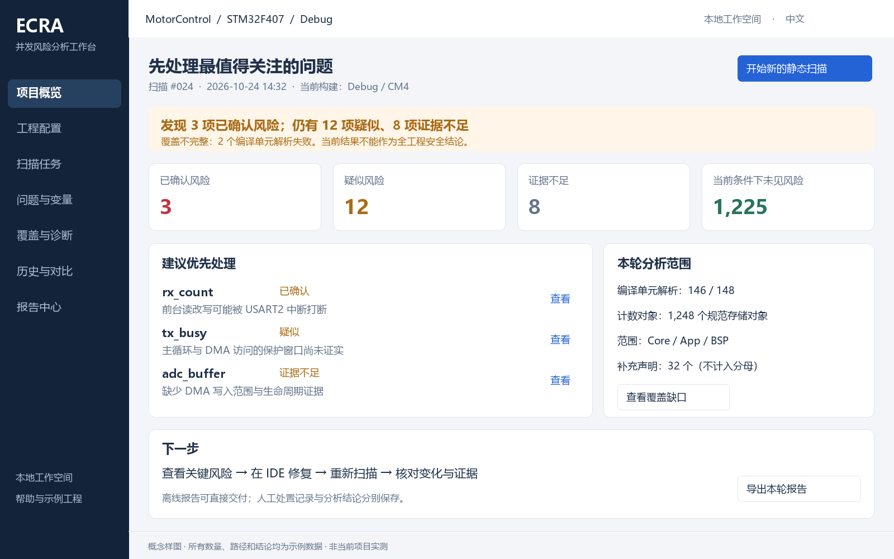
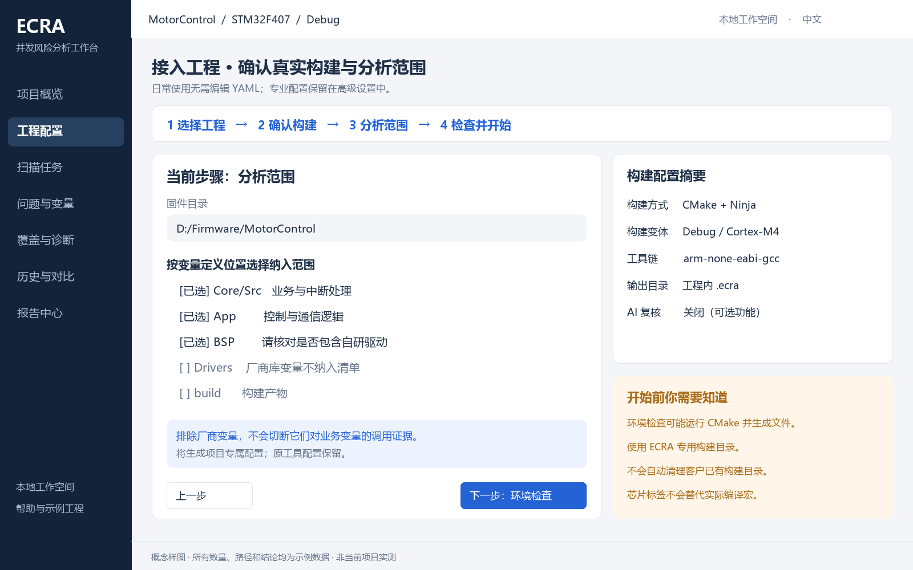
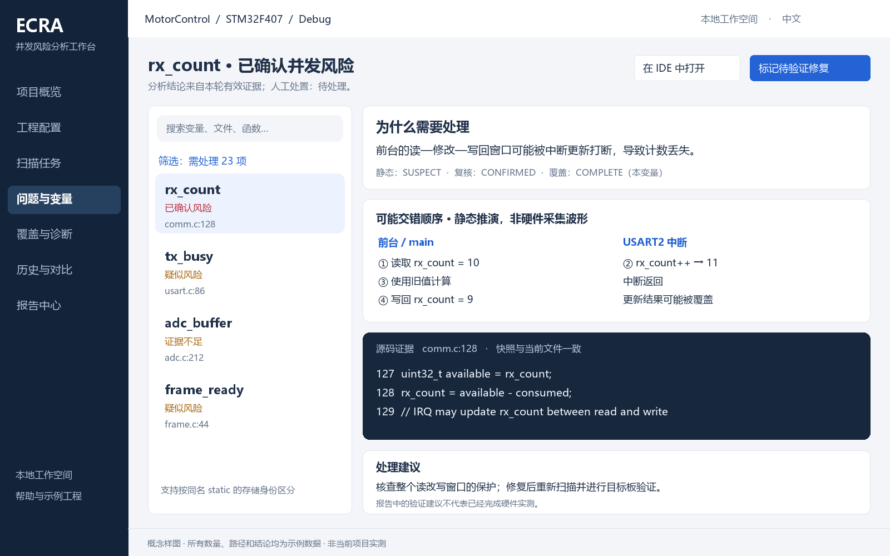
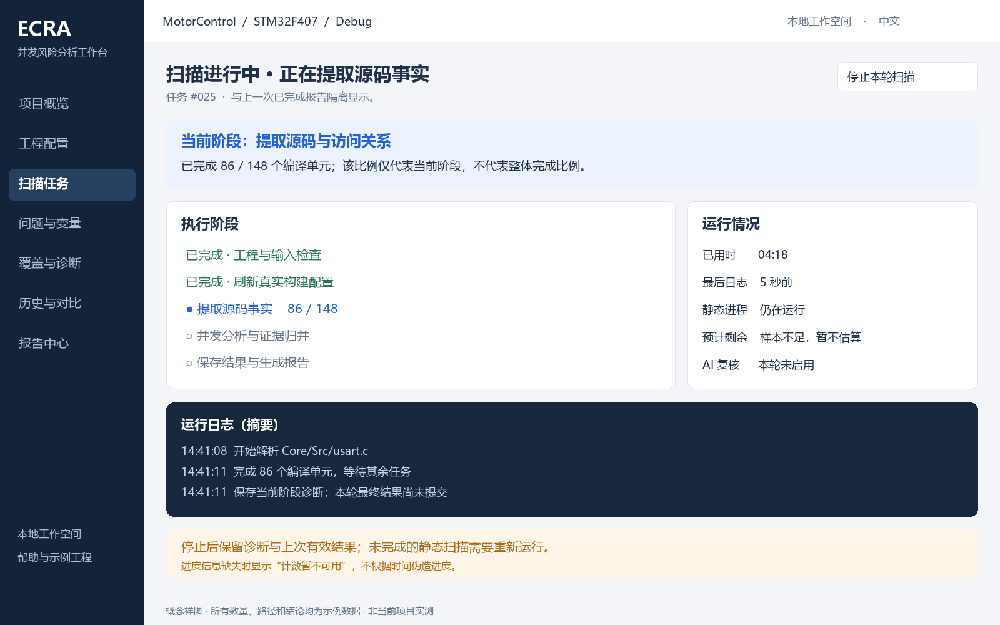

# ECRA 上位机产品与技术方案

> 版本：V1.0｜日期：2026-10-24｜性质：产品规划与技术设计，待立项评审
>
> 适用项目：当前 STM32 全局 / static 变量并发排查工具 ECRA。
>
> 本次交付仅包含方案和界面样图；未修改或运行项目分析代码，未执行固件构建，未调用模型复核。文中“建议、规划、目标、拟新增”均不表示功能已经实现。四张样图为原创概念图，使用虚构演示数据，不是当前项目扫描结果，也不是厂商产品截图。

## 1. 方案主张

建议将上位机定位为 **“面向嵌入式研发与质量团队的本地并发风险分析工作台”**，暂定产品名 **ECRA Studio**。客户打开软件后，应能完成工程接入、静态扫描、问题定位、处理记录、修复后验证和报告交付，不需要理解 Python 启动方式、YAML 缩进或内部分析数据结构。

第一版以 **Windows x64、中文、离线静态分析、单机工作空间** 为主，推荐 **PySide6 / Qt Widgets 桌面界面 + 独立 ECRA 分析进程 + 本地结果适配层**。复用现有分析引擎和 HTML 报告，不在界面层重新实现风险判定。

产品设计围绕客户的五个问题展开：

1. 我的工程能否直接使用，需要准备什么？
2. 本次到底分析了哪些代码，还有哪些地方看不到？
3. 哪些问题值得先处理，为什么认为它们有问题？
4. 我修改后，原来的问题是否得到有效验证？
5. 我能否把可解释、可追溯的结果交给同事或客户？

本项目的“上位机”主要操作源码、构建配置和分析结果。串口调试、CAN 通信、烧录、在线寄存器修改和真实波形采集不进入第一版范围；后续若接入目标板验证，应作为独立能力立项。

## 2. 设计依据与现状核查

### 2.1 核查范围

本方案基于当前工作区的源码、配置与文档静态阅读，以及厂商官方公开资料。没有重新跑测试、进行性能基准或实际试用商业工具；对厂商的评价限于可核实的公开功能和由此推导的设计启发。

| 本地依据 | 本次确认的信息 | 对上位机的约束 |
|---|---|---|
| [README](../README.md)、[使用教程](one-command-tutorial.md) | 当前主要通过命令行与配置文件使用；输出本地 HTML、JSON、Markdown、SQLite | 图形化接入和结果导航优先于新增分析算法 |
| [命令入口](../ecra/cli.py) | 存在 `run / init / doctor / review / review-failed / report / status`；支持显式 `--config` | 首期可以通过进程调用接入，但需要命令级状态解释 |
| [当前配置](../config/semantics.yaml)、[配置模块](../ecra/config.py) | 工程根目录、纳入/排除范围、CMake、入口语义、复核设置集中管理 | 表单应覆盖高频字段，并保留高级配置 |
| [结果流程](../ecra/workflow.py)、[输入快照](../ecra/input_snapshot.py) | 保存结果与输入、分析配置及引擎指纹关联，复用前有校验 | 旧结果必须有明确的有效性提示 |
| [结果判定](../ecra/decisions.py)、[复核协议](../ecra/review_contract.py) | 静态结论、复核结论、执行状态不是同一概念 | UI 不可将“复核完成”直接变成“风险已排除” |
| [报告生成](../ecra/report.py)、[HTML 报告](../ecra/html_report.py) | 已有变量清单、证据与汇总，以及 SQLite 输出 | 复用语义与已有报告，另建适合 UI 查询的薄索引 |
| [诊断模块](../ecra/scan_diagnostics.py) | 有阶段记录、内存诊断、异常记录 | 可以展示阶段和诊断；不能假定已有稳定实时事件协议 |
| [便携交付记录](portable-delivery-report.md)、[打包版本清单](../config/portable_sources.psd1) | 已有 Windows Full Portable 交付基础 | 新 GUI 应纳入离线包验收，不能仅在开发电脑验证 |

**发现的版本信息差异：** README 中出现 Python 3.12.10 的描述，而本次读取的 `portable_sources.psd1` 和既有便携交付记录采用 3.10.9，`pyproject.toml` 声明 Python ≥3.10。方案不替它们选择一个“已验证的当前版本”。立项时应以待交付二进制实测与包清单统一运行时版本，再选择兼容的 GUI 依赖，并同步文档。此次不修正文档或配置。

### 2.2 已有能力与产品缺口

| 能力 | 当前基础 | 上位机需要补齐 |
|---|---|---|
| 项目接入 | CMake 工程与已有编译数据库；初始化模板 | 向导、检测结果、构建变体提示、路径迁移 |
| 变量与存储对象盘点 | 全局/static、成员/元素、定义与访问证据 | 客户可理解的筛选、同名身份区分、按需展开 |
| 并发分析 | 物理上下文、调用/别名、保护、初始化、NVIC 等事实 | 分层解释、证据定位、可读的可能交错顺序 |
| 覆盖诊断 | 解析失败、相关未知、范围与构建闭包信息 | 根因聚合、影响范围与解决入口 |
| 分析运行 | 命令、日志、状态文件、扫描锁 | GUI 生命周期管理、异常恢复提示、可靠停止 |
| 复核 | 当前存在 OpenCode 复核与失败重试 | 可选接入、数据边界说明、状态解释；基础产品不依赖它 |
| 结果交付 | HTML/Markdown/JSON/SQLite、历史快照、基础 finding ID 差集 | 客户报告包、版本标识、有效性与源文件一致性提示 |
| 客户日常管理 | 未在已读入口中发现完整桌面项目工作空间 | 项目列表、每项目配置、人工处置、稳定基线比较 |

当前仓库包含部分 C++、任务、DMA 和多核相关支持，但本轮没有逐一验证其边界。第一版的销售与验收口径应聚焦现有最明确的 **STM32 裸机 C 工程**；不能因存在模块或配置项，就宣传完整支持任意 RTOS、任意多核或全部 C++ 运行语义。

## 3. 客户、场景与成功标准

### 3.1 目标客户与使用角色

| 角色 | 实际目标 | 当前可能遇到的障碍 | 产品需要提供的帮助 |
|---|---|---|---|
| 嵌入式开发工程师，主要用户 | 找到变量冲突并定位代码 | 不熟悉分析配置；报告太多，不知从何看起 | 推荐配置、优先处理列表、源码与证据联动 |
| 技术负责人 / 架构师 | 判断问题是否成立、是否影响交付 | 风险数、未知数和复核进度容易混淆 | 结论与覆盖分开，保留假设、依据与适用范围 |
| 测试 / 质量工程师 | 跟踪修复、整理验收材料 | 扫描批次混淆、缺少变化解释 | 历史记录、基线差异、处置记录与可追溯报告 |
| FAE / 支持人员 | 帮客户接入工程与排查环境 | 需要反复远程指导配置与收集日志 | 诊断卡片、示例工程、经用户选择的诊断包 |

优先服务“工程可以正常构建，但客户没有静态分析经验”的团队。暂不把平台管理员、多部门权限审批或在线协作设为第一版前提。

### 3.2 关键客户旅程

| 阶段 | 用户动作 | 系统应完成的工作 | 用户看到的下一步 |
|---|---|---|---|
| 首次启动 | 打开软件，选示例或自己的工程 | 检测本地运行环境，介绍适用范围 | “打开工程”或“体验示例” |
| 工程接入 | 选择目录、构建方式、变体与范围 | 校验真实输入，显示将生成文件的位置 | “检查环境并开始扫描” |
| 扫描中 | 查看进度，需要时停止 | 后台运行，显示阶段、日志、诊断 | “查看日志”或“停止本轮扫描” |
| 阅读结果 | 打开优先问题 | 说明风险、条件、缺口及源码位置 | “查看证据”“在 IDE 中打开” |
| 处理问题 | 在 IDE 修改，记录处理意见 | 保存独立的人工处置记录 | “重新扫描验证” |
| 修复验证 | 选择同一构建配置重新扫描 | 区分风险消失、范围变化与证据缺失 | “核对本次变化” |
| 交付 | 选择摘要与证据内容 | 导出离线报告包及有效性说明 | “打开导出目录” |

### 3.3 客户价值指标

以下是 **待用户测试确认的产品目标**，不是当前已达成数据。

| 指标 | 建议目标 | 测量方法 |
|---|---|---|
| 标准样例接入 | 初次用户 10 分钟内完成配置并启动扫描，不含扫描耗时 | 5–8 名目标用户独立操作，记录失败步骤 |
| 无命令行完成核心路径 | ≥80% 测试用户可独立完成打开工程到导出报告 | 同一操作脚本；只提供产品内帮助 |
| 风险解释可理解 | ≥80% 用户能说出涉及的变量、上下文、可能交错与缺失条件 | 选取已知真值案例，访谈确认 |
| 日常复用 | 已接入工程在主界面一次操作即可发起同配置扫描 | 不要求重复填写模型或工具链信息 |
| 结论不误导 | 验收案例中，零次把失败、未知或过期结果显示为已安全 | 对照测试矩阵逐项记录 |
| 售后成本 | 试点后与命令行方式比较接入耗时和支持次数 | 客户同意后记录，不默认上传遥测 |

## 4. 专业厂商工具调研

### 4.1 调研方法与结论边界

资料访问日期为 **2026-10-24**。选择 ST、SEGGER、MathWorks、NI 四家，是为了分别观察嵌入式监控、源码调试、静态分析审查和工程化测试工作台。它们不是同一品类，下面不做性能排名或功能数量竞赛。

表中“官方可核实功能”为资料事实，“本项目借鉴方式”为本方案判断。没有实际安装试用，因此不对易用性、稳定性、性能或采购价格作实测结论。

### 4.2 对标矩阵

| 厂商 / 工具 | 官方可核实功能 | 本项目借鉴方式 | 不直接照搬的内容 |
|---|---|---|---|
| ST · STM32CubeMonitor | 图形化流程编辑、变量监视、自定义仪表界面、记录与回放 | 高频使用进入结果工作台，专业配置在独立页面；优先提供可直接使用的默认布局 | 首版不要求客户搭建节点流程；不把静态推演画成实测波形 |
| SEGGER · Ozone | 工程向导、源码/变量等多窗口视图、布局调整、调用栈时间线 | 问题列表、源码和证据联动；渐进展开工程细节 | 不内置完整 IDE、烧录器或在线调试协议 |
| MathWorks · Polyspace Access | 项目总览、可下钻统计卡片、质量目标、历史趋势与审查状态 | 总览回答“需要处理什么”；点击统计定位对象；技术结论和处理进度分别显示 | 不把完成率当安全率；不把企业服务器设为单机使用前提 |
| NI · InstrumentStudio | 以项目组织配置、文件和测量界面；项目文件窗格与配置面板 | 项目是客户的工作单元，配置和结果随项目组织，支持导入与导出 | 不引入与本项目无关的仪器通道和硬件参数面板 |

资料依据：[ST 官方产品页](https://www.st.com/en/development-tools/stm32cubemonitor.html)、[Ozone 官方功能概览](https://www.segger.com/products/development-tools/ozone-j-link-debugger/technology/tool-overview/)、[Polyspace Access 官方 Dashboard 文档](https://www.mathworks.com/help/polyspace_access/ug/dashboard-web-browser.html)、[NI InstrumentStudio 官方界面文档](https://www.ni.com/docs/en-US/bundle/instrumentstudio/page/interface.html)。

### 4.3 提炼出的产品决策

专业感主要来自工程管理、信息层级、可信状态和可靠恢复，而不是仪表盘数量。建议形成以下设计约束：

- **先给可执行结论。** 首页显示下一步动作，不先展示内部算法与全部日志。
- **让用户始终知道自己正在看哪个工程、构建变体和扫描批次。** 这是跨项目、跨版本使用的基础。
- **风险必须可追溯。** 从总览到变量，再到真实源文件位置，形成一致的导航路径。
- **常用操作简单，专业能力有入口。** 默认表单覆盖高频配置，底层语义与证据不被删除。
- **没有结果也要有清晰体验。** 无工程、无编译数据库、扫描失败、无风险线索和结果过期分别设计。

## 5. 产品范围与版本划分

### 5.1 首版承诺边界

| 维度 | V1 建议范围 | 暂缓内容 |
|---|---|---|
| 平台 | Windows x64，具体 Windows 版本随 Qt 与运行时兼容测试冻结 | macOS / Linux 桌面适配 |
| 输入 | STM32 裸机 C；CMake 或用户提供真实编译数据库 | 声称原生一键支持所有 Keil/IAR 工程 |
| 工作方式 | 本地分析，本地查看，离线交付 | 必须注册账号、必须云端上传 |
| 并发任务 | 多项目记录；同一时间运行一个完整静态扫描任务 | 多工程同时扫描和资源调度集群 |
| 结果工作流 | 问题定位、覆盖诊断、人工备注、重新扫描、报告导出 | 多人实时协作和服务端权限体系 |
| AI | 可选扩展；默认静态流程独立可用 | 将 AI 作为扫描和报告生成的必选依赖 |
| 固件操作 | 在 IDE 中查看和由客户修改 | 自动改源码、烧录、连接目标板写寄存器 |

对于 Keil / IAR 用户，导入页应写清“需提供可被当前引擎处理的真实编译参数与数据库，并通过兼容验收”。不能用手写一组猜测的宏和包含路径来伪装已完成工程接入。

### 5.2 功能优先级

| 优先级 | 功能 | 理由 |
|---|---|---|
| P0，首个客户可用版本 | 工程向导、静态扫描、阶段进度、停止与失败处理、变量与证据、覆盖诊断、HTML 报告导出、项目配置保存 | 覆盖不依赖模型的完整操作路径 |
| P0，可靠性基础 | 输入有效性、旧结果标识、配置隔离、进程锁、结果原子提交、离线便携验收 | 防止客户得到错误或混淆结果 |
| P1，稳定版 | 人工处置、基线对比、历史筛选、诊断包、可选 AI 复核面板、只读报告包导入 | 形成持续使用与支持闭环 |
| P2，按需求立项 | PDF 品牌报告、批量项目、CI 结果导入、团队协作、更多工程适配 | 需要真实客户价值与新增成本验证 |

四张样图展示目标工作台，可能包含 P1 操作；P0 中尚未实现的功能应隐藏或明确显示“规划中”，不能用无响应按钮代替真实能力。

## 6. 信息架构与导航

```text
ECRA Studio
├─ 欢迎 / 项目选择：最近项目、打开工程、体验示例、打开报告包
└─ 当前项目工作空间
   ├─ 项目概览：当前结论、优先事项、覆盖摘要、下一步
   ├─ 工程配置：构建方式、范围、入口语义、专业配置
   ├─ 扫描任务：当前阶段、日志、诊断、停止、历史任务
   ├─ 问题与变量：处理队列 / 完整清单 / 变量证据
   ├─ 覆盖与诊断：解析失败、未知根因、影响对象
   ├─ 历史与对比：扫描批次、基线、变化原因
   └─ 报告中心：摘要、完整报告、离线交付包
全局设置：本地工具、IDE 跳转、显示、存储、可选复核
```

顶部固定显示工程名、源目录简称、构建变体、当前扫描批次；结果过期时在标题下方显示醒目的文字提示。底部显示任务状态与工作空间位置，状态不能仅靠颜色传递。

首页主按钮随状态变化：首次为“接入工程”，配置可用时为“开始静态扫描”，执行中为“查看扫描进度”，结果过期时为“重新扫描”。避免多个同等突出的主要操作争夺注意力。

## 7. 页面功能与交互规格

### 7.1 欢迎页与项目管理

最近项目卡片显示名称、真实路径、最后有效扫描时间、构建变体和上次结果是否仍可使用。路径不存在时保留记录并提供“重新定位”，不能静默创建空目录。

提供一个随包分发的小型教学工程：包含明确的读改写风险、严格保护示例和证据不足示例。示例结果必须标识为示例；客户自己的项目不会被自动替换为教学数据。

项目删除默认只移除工作空间登记；清理扫描产物是独立操作，需要显示实际目录、占用空间及保留策略。不要将“移除项目”实现为递归删除源码。

### 7.2 工程接入向导

采用四步流程，各步骤可返回修改并保留输入：

1. **选择工程。** 目录选择、CMake / 编译数据库识别、文件可访问性检查。
2. **确认真实构建。** 编译数据库位置或 CMake 参数、工具链、构建变体、预期宏、专用构建目录。
3. **确认分析范围。** 以目录树展示纳入/排除，明确自研 BSP、驱动和中间件的归属；展示规则原因与最终范围。
4. **检查并开始。** 列出检查结果、将执行的构建步骤、输出位置和可选复核开关，提供开始操作。

关键交互约束：

- 目录名称只用于生成建议，不能自动确认第三方归属；自研代码可能位于 `Drivers` 或 `BSP`。
- 明确区分“变量不纳入清单”和“相关依赖仍参与调用/访问恢复”。
- 芯片、位宽等描述性设置不能被说明为已替代真实编译宏与工具链参数。
- 用户切换 Debug/Release、板卡或核时，保存为不同配置档案，并重新确认编译数据库。
- 初步检查是路径与配置检查；深度环境检查复用 `doctor` 时可能运行 CMake、构建或生成文件，界面必须提前说明。
- 对未知字段、旧配置、自定义语义保持兼容；表单不能在保存时丢失用户的高级字段和注释。若无法保留，应阻止覆盖并提供另存副本。
- 第一版只提供必要的高级 YAML 查看/编辑入口，避免制造一个功能不完整的 IDE。

### 7.3 项目概览

概览不是单一绿色“通过”页面，应包含：

| 区域 | 内容 | 行为 |
|---|---|---|
| 结论横幅 | 有已确认风险 / 存在疑似或证据缺口 / 当前条件下未发现风险 | 使用引擎有效结论，不自行推断 |
| 风险卡片 | 已确认、疑似、证据不足、当前条件下未见风险 | 点击进入相同口径的对象列表 |
| 覆盖卡片 | 编译单元解析、对象覆盖、构建与排查范围、补充声明 | 点击进入覆盖诊断；不生成“安全百分比” |
| 优先处理 | 3–5 个需要立即查看的对象或根因 | 定位证据，不默认只按变量名字排序 |
| 下一步 | 修复风险、补齐输入、重新扫描或导出 | 随状态改变，避免无条件推荐 AI |

问题排序先看有效风险等级，再看证据明确程度和客户设置的业务重要性。对“共享变量”本身不直接标红；一个变量有多个访问证据时，避免按访问条数放大风险数量。

### 7.4 问题与变量工作台

采用左侧结果列表、右侧证据详情；源码区可与详情上下分割。初始布局固定而易懂，后续允许调整面板宽度并恢复默认。

列表默认字段：变量/成员名称、有效结论、覆盖状态、主要执行上下文、定义位置、人工处置、扫描批次。高级列可显示存储身份和底层状态。

支持按名称、文件、函数、IRQ、结论、未知原因搜索筛选。`全部清单` 与 `需处理问题` 是两个明确视图；常量、未使用对象和未编译补充声明不能悄悄消失。

详情按客户理解顺序组织：

1. 一句话说明：涉及什么存储对象，为什么需要关注。
2. 谁在访问：物理执行域、读/写方式、调用入口。
3. 可能发生什么：分步骤的交错顺序及成立条件。
4. 有什么保护：临界区、初始化顺序、优先级与有效性依据。
5. 证据在哪里：文件、行号、邻近代码、调用链与别名关系。
6. 仍缺什么：未知事实对当前对象的具体影响。
7. 下一步：修复方向、验证建议、处置记录。

可能交错视图使用“步骤 1/2/3”，不使用伪造的毫秒刻度。存在源码 NVIC 配置不等于已证明运行期屏蔽和优先级持续有效；解释区需要区分两者。

同名 static 必须带定义文件及编译单元身份；成员对象、数组元素与父对象的汇总关系可展开。初始化阶段、`volatile`、自然对齐、单 writer 等内容必须按已有证据解释，不能被 UI 转换为快捷安全开关。

### 7.5 源码导航

提供只读源码视图及“在 IDE 中打开”。首次配置 IDE 路径后，以参数数组传入文件和行号；不把用户路径拼成可执行 shell 字符串。

优先显示扫描证据对应的快照片段，并标明来源。当前文件与证据 hash 不一致时，显示“源码已变化”，允许打开现有文件，但不能继续暗示相同行号就是原始证据。

没有归档的完整文件不伪装为完整快照；报告包只有片段时，应说明浏览范围。移交后本机找不到工程路径，应优先使用随包证据并允许用户映射新根目录。

### 7.6 覆盖与诊断

覆盖问题按根因聚合，例如缺头文件、宏配置不匹配、失败编译单元、函数指针目标未解析、外部异步行为未建模。每条根因显示影响对象数量、具体位置、推荐操作和再扫描要求。

“2 个文件解析失败”不等同“剩余所有变量未知”，也不等同“影响很小可以忽略”。相关性应来自引擎证据。缺少量化依据时直接显示“影响范围待确认”。

覆盖页同时保留零变量文件和排除清单，帮助客户发现错误范围。不能只展示“成功解析的文件”制造完整覆盖印象。

### 7.7 扫描任务中心

展示准备、构建、输入快照、提取、分析、结果保存与报告生成等实际阶段；阶段名称由适配层映射，保留原始日志。

当前引擎没有在本轮核查中确认稳定的细粒度实时事件接口。P0 先使用阶段日志和已存在的诊断文件；拿不到实时 `completed/total` 时显示不定进度，不从耗时猜出百分比。样图中的编译单元实时计数需要后续结构化事件支持后才能兑现。

建议常规 UI 刷新 0.5–2 秒一次，但不要以这个频率调用完整 `status --json`：其内部可能读取报告并校验输入及复核收据，成本不等同于轻量心跳。完整状态检查在打开项目、任务完成和用户请求验证时异步执行。

按钮使用“停止本轮扫描”，不提供没有实现保证的“暂停并继续”。取消后，静态分析通常重新运行；复核失败重试属于另一个已有流程，不能混称通用断点续跑。

### 7.8 人工处置与修复验证（P1）

建议状态为：待处理 → 分析中 → 待验证修复 → 已验证关闭；另外提供“接受风险”和“待补充信息”。每次变更记录操作者、时间、理由与关联扫描。

人工状态独立保存，不能修改静态结论、模型结论或覆盖事实。“接受风险”仍是风险；“标记已修复”只进入待验证，不自动变绿。

关闭问题至少需要同一可比构建范围的重扫结果与人工确认。对于源码风险消失但硬件条件仍需验证的情况，保留目标板验证待办，不声称已实测。

### 7.9 历史与基线比较（P1）

基线比较前检查项目身份、构建变体、范围、宏、引擎版本及语义配置差异。比较结果分为新增、持续存在、结论变化、本轮未观察到、无法比较。

“本轮未观察到”不能自动叫“已修复”：变量可能被排除、宏分支可能关闭、文件可能解析失败。只有覆盖条件充分且客户确认后，才能关闭处置项。

当前已有 finding ID 差集基础，但不能等同于稳定跨版本缺陷跟踪。行号移动、重命名和存储身份变化时，可使用定义身份、上下文和证据摘要辅助匹配；低可信匹配要人工确认，不能自动继承历史忽略或安全结论。

### 7.10 报告中心

P0 优先交付完整 HTML 报告包及摘要 Markdown；JSON 供技术人员复用。PDF 模板和品牌定制放到 P2，避免延迟核心功能。

报告包含：项目与构建、扫描时间、引擎/配置版本、结论、覆盖范围和盲区、风险清单、证据、建议、人工处置与结果有效性。导出时从同一个已提交批次取数，不能混用不同扫描目录中的文件。

提供“完整工程内部版”和“客户摘要版”两种内容选择：后者默认不带完整源码、绝对路径和详细模型日志；但必须保留范围、未知与限制，不能变成删掉不利信息的美化报告。

HTML 可能引用 `html_details` 等附属文件，导出必须收集依赖，不能只复制 `index.html`。离线包附 manifest、文件 hash 与说明；hash 可发现内容变化，不等于身份认证或数字签名。

## 8. 结论、覆盖与任务状态规则

### 8.1 五个独立维度

| 维度 | 内容示例 | 禁止的错误合并 |
|---|---|---|
| 风险结论 | 已确认、疑似、未知、静态已排除、复核后未发现风险 | 未复核不能把原静态疑似抹掉 |
| 覆盖 | `COMPLETE / PARTIAL` 及缺口 | 风险已确认仍可同时覆盖不完整 |
| 执行 / 复核状态 | 等待、运行、结束、技术失败 | 技术失败不等于没有风险 |
| 结果有效性 | 当前有效、输入变化、完整性异常、历史只读 | 旧结果不能默认替代本轮结论 |
| 人工处置 | 待处理、待验证、已关闭、接受风险 | 人工关闭不改写引擎事实 |

### 8.2 原始状态与客户文案

| 原始信息 | 建议客户文案 | 说明 |
|---|---|---|
| `SUSPECT` | 疑似并发风险 | 已有冲突线索，待核实成立条件 |
| `UNKNOWN` | 证据不足，暂无法判断 | 显示缺少的事实及补齐路径 |
| `SAFE_PROVEN` | 当前分析条件下已排除风险 | 展示安全理由和证据，不能省略范围 |
| `SHARED_NO_REVIEW` | 共享访问，已按规则筛除 | 保留该类别，不包装成静态安全证明 |
| `OUT_OF_BUILD` / 补充声明 | 不在当前构建，仅盘点 | 不计作 SAFE，不计入当前构建分类分母 |
| `CONFIRMED` | 已确认并发风险 | 指分析/复核证据结论，不代表硬件复现 |
| `LIKELY` | 疑似风险，条件待确认 | 不计入已确认或已解决 |
| `REVIEWED_SAFE` | 复核后在所述条件下未发现风险 | 保留适用条件及依据 |
| `FALSE_POSITIVE` | 此静态疑点已证伪 | 与上述复核安全保留原始区别 |
| `NEED_MORE_CONTEXT` | 需要补充证据 | 是正常复核答复，不是技术失败 |
| `PENDING / TECH_FAILED` | 待复核 / 复核执行失败 | 同时保留静态风险结论 |

对底层未识别或未来新增枚举，显示“未知状态：原始值”并提示版本兼容问题；不能以默认分支映射为安全。

### 8.3 统计口径

以引擎认可的规范存储对象为分类分母，说明对象可能是变量、成员或已知数组元素；父对象汇总不重复计数。完整清单展示数与分类分母可能不同，应同时解释。

首页卡片若汇总静态已排除和有效复核安全，点击后必须能分别看到子类别。`SHARED_NO_REVIEW`、一般盘点项和补充声明不偷偷加入“已排除”统计。

任务执行完成、复核有答复、风险已判定和人工处理完成分别计算。没有需要复核的对象时显示“无待复核对象”，不要借一个 100% 给出项目全面安全暗示。

样图仅为便于理解，假设 1,248 个分类对象恰好分为 3 个已确认、12 个疑似、8 个证据不足、1,225 个当前条件下未见风险；另有 32 个补充声明。它不代表所有真实项目都只有这四类。

## 9. 基础界面样图与视觉规范

### 9.1 样图一：项目概览



设计重点：在同一屏看到风险和覆盖缺口，卡片可下钻，明确下一步。此例中的已确认结论可来自已保存的有效复核结果；“本地工作空间”不表示这些结论全部由静态扫描直接产生。

### 9.2 样图二：工程接入向导



设计重点：客户选择实际业务目录，右侧随时看到构建摘要；开始检查前说明生成文件和专用目录。截图中路径和工具链均为示例。

### 9.3 样图三：变量证据工作台



设计重点：不要求用户先阅读长篇报告；先看一句话理由，再看交错步骤与源码。图中 `rx_count` 代码是解释用伪示例，真实产品必须绑定实际文件和证据快照。

### 9.4 样图四：扫描任务



设计重点：当前阶段计数与整体完成分开；缺少可靠估时就直接说明。编译单元实时计数、进程活动检测和可靠停止均需 GUI/协议适配验证，不是对当前 CLI 的现成功能承诺。

### 9.5 单 Markdown 阅读时的结构样图

完整视觉稿使用同目录下的 PNG 附件；若只传递本 Markdown，下面的线框仍可独立说明基本布局：

```text
+------------------+---------------------------------------------------------+
| ECRA Studio      | 工程 / 构建变体 / 扫描批次                  [开始扫描] |
|------------------|---------------------------------------------------------|
| 项目概览         | 当前结论：存在风险；覆盖尚不完整                       |
| 工程配置         | [已确认] [疑似] [证据不足] [当前条件下未见风险]        |
| 扫描任务         |---------------------------------------------------------|
| 问题与变量       | 优先处理的问题                  | 本轮分析范围          |
| 覆盖与诊断       | 变量、原因、来源、查看证据      | 编译配置、覆盖缺口    |
| 历史与对比       |---------------------------------------------------------|
| 报告中心         | 下一步：处理风险 / 补齐输入 / 重新扫描 / 导出报告       |
+------------------+---------------------------------------------------------+

问题与变量： [搜索 / 筛选] → [变量列表] → [一句话结论 / 交错步骤 / 源码证据]
工程接入：   [选择工程] → [确认构建] → [选择范围] → [检查并开始]
扫描任务：   [当前阶段] + [可用的真实计数] + [日志] + [停止 / 查看诊断]
```

### 9.6 视觉与可用性约定

- 浅色内容区、深色导航栏、蓝色主要操作；红色表示已确认风险，橙色表示疑似或需注意，灰蓝色表示未知，绿色只表达有依据的排除状态。
- 颜色必须伴随文字或图标；不依赖红绿区分完成操作。
- 采用系统中文字体、统一 8 px 间距体系；建议正文 14–16 px，表格行高 32–40 px，源码可单独调字号。样图为 1600×1000 构图，不是最终像素规格。
- 目标支持 1366×768 起的窗口及 100%–200% DPI；窄屏优先折叠详情面板，保持主动作、结论与搜索可见。
- 支持键盘选择、Tab 顺序、复制证据、搜索快捷键；不使用复杂动画干扰大表格操作。
- 空状态明确区分“无匹配筛选项”“本轮无风险线索”“尚未扫描”“结果不可用”。

## 10. 技术路线比较与推荐

### 10.1 候选路线

以下是结合当前仓库与团队能力假设的工程判断，不是实测性能排名。

| 路线 | 对本项目的适配价值 | 主要代价 | 建议 |
|---|---|---|---|
| PySide6 / Qt Widgets + Python 子进程 | 与现有 Python 技术栈衔接；适合表格、树、原生文件操作 | 需要 GUI 分层、打包兼容与 Qt 分发评估；复杂网页样式需重做 | **首选** |
| Electron + Web 前端 + Python sidecar | 若团队已有 Web 能力，复杂交互和网页组件复用较方便 | 引入 Node/Chromium 与 Python 两套运行环境；需单独设计进程通信边界 | 团队明显偏 Web 时作为备选 |
| C# / WPF + Python 子进程 | Windows 产品团队可复用已有桌面经验 | 跨语言适配，跨平台演进成本需另评估 | 仅在现有团队以 .NET 为主时考虑 |
| 浏览器本地服务 + Web 页面 | 可较快复用现有 HTML，适合内部验证 | 本地服务生命周期、端口、安全与客户安装体验需解决 | 可用于概念验证，不作为默认交付结论 |

Qt 的 `QProcess` 提供进程状态及标准输出/错误信号，`QTableView` 提供 model/view 表格机制，可分别用于分析进程适配与大列表显示；是否达到性能目标仍需本项目原型验证。[QProcess 官方文档](https://doc.qt.io/qtforpython-6/PySide6/QtCore/QProcess.html)、[QTableView 官方文档](https://doc.qt.io/qtforpython-6/PySide6/QtWidgets/QTableView.html)。

Qt for Python 存在社区与商业分发路径。立项时应选定模块、版本和分发方式，确认依赖许可与交付材料；本方案不承诺某一种封装自动满足全部商业分发条件，也不估计未经核实的授权价格。[Qt for Python 官方商业使用说明](https://doc.qt.io/qtforpython-6.10/commercial/index.html)。

### 10.2 推荐架构

```text
客户操作
   │
   ▼
桌面展示层：项目 / 配置 / 任务 / 变量 / 证据 / 报告
   │ 发出业务操作；不执行分析算法
   ▼
应用服务层：配置档案、任务控制、结果索引、处置、导出
   │
   ├── 引擎适配层 ──独立进程──► 现有 ECRA CLI / 分析引擎
   │       ▲                         │
   │       └── 日志、状态、已提交结果 ┘
   │
   ├── 只读结果索引 ◄── facts.db / JSON / HTML / 快照
   └── 本地工作空间：项目元数据、人工记录、UI 设置

可选复核适配器：显式启用后调用现有复核流程；基础静态路径不依赖它
```

分析进程与 UI 隔离，长时间解析、构建和报告生成不会占用界面线程。QProcess 适合执行与输出读取，但不能独自保证 Windows 全部子进程的可靠停止，仍需任务监督与进程树回收设计。

第一版不引入公共 HTTP 服务。已有 HTML 报告优先在系统浏览器中只读打开；如未来引入嵌入式 WebView，应单独评估依赖体积、内容隔离与脚本权限。

## 11. 现有引擎接口与适配计划

### 11.1 命令映射

| 客户操作 | 现有接入点 | 注意事项 |
|---|---|---|
| 建立新配置 | `init --project ... --config ...` | 目标配置必须不存在；不覆盖现有唯一配置 |
| 深度环境检查 | `doctor --config ...` | 可涉及构建；命令可用不代表模型连接已验证 |
| 静态扫描 | `run --config ... --no-review` | 即使原配置启用 review，首期静态按钮仍明确关闭复核 |
| 查看已保存状态 | `status --config ... --json` | 可能执行完整性/新鲜度检查，不当作高频心跳 |
| 重新复核 | `review --config ...` | 仅在用户显式启用可选能力后使用；输入变化可能要求重扫 |
| 重试技术失败项 | `review-failed --config ...` | 不等于重新处理所有疑似项或恢复静态扫描 |
| 刷新已保存报告 | `report --config ...` | 不是重新分析源码，也不是重新判断风险 |

上表是未来实现的接口设计，本次没有执行这些命令。`--json` 目前仅属于 `status`，不能想当然加到所有命令上。

### 11.2 退出码解释

当前 `run` 分支有 0、1、2、3、130 等退出码；其中 1 与 findings 存在相关，不可简单解释为程序崩溃，也不可直接解释为“已确认缺陷”。2 通常关联结果不完整，3 为执行/准备失败，130 为中断。其他命令有自己的语义，例如 `doctor` 的 2 可以表示复核命令不可用。

适配层必须结合 **命令类型、进程退出状态、`run.json`、`result_validity.json`、报告有效性及诊断** 判定界面状态。非零退出不能统一显示“扫描失败”；零退出也不能覆盖过期、完整性异常或覆盖不足。

### 11.3 结果读取与语义复用

- P0 通过独立适配器读取已保存报告和只读 SQLite，将 UI 所需字段投影到稳定视图模型。
- 风险聚合遵循 `decisions.py`、报告中的有效决策与相关证据；GUI 不复制一套简化规则。
- 当前 SQLite 表列由事实结构生成，部分复杂值以 JSON 存储，不能假设是长期稳定的 UI API。
- 建议新增可丢弃、可重建的 GUI 索引，保存搜索字段、计数及证据定位；不在引擎 `facts.db` 中写入人工状态。
- 导入未知版本数据先做兼容检查；不支持的文件以历史只读方式打开原报告，或明确拒绝，不静默丢字段。
- 完整 JSON 与大量证据按需加载，避免启动时把全部源码、访问图和日志展开进内存。

### 11.4 后续建议增加的结构化事件协议

以下协议是 **待新增设计**，当前不能按已存在的接口承诺：

| 字段 | 用途 |
|---|---|
| `schema_version / run_id / sequence` | 协议兼容、批次隔离、顺序与去重 |
| `event_type / stage / timestamp` | 阶段开始、进度、诊断、结果提交、终态 |
| `completed / total / unit` | 真实已知分母的阶段计数；未知时允许为空 |
| `severity / code / message` | 可翻译的客户提示与可检索错误 |
| `artifact / validity` | 已提交结果位置、当前是否可用 |

采用单向 JSON Lines 事件流或受控事件文件；日志继续单独保留。事件写入应由单一协调者保证顺序与完整行，UI 能处理重复、截断尾行、缺失和乱序。阶段进度不通过简单平均合成为全流程百分比。

### 11.5 可靠停止与恢复

拟采用本机任务监督器记录进程身份、启动时间与所属 run，优先请求有界的协作停止；超时后仅回收该任务拥有的进程树。Windows 上需要专门验证进程组 / Job Object 与 CMake、编译器、Python worker 的实际行为，不把 `QProcess.terminate()` 视为可靠取消的全部实现。

强制终止后，若引擎没有生成终态，GUI 只记录独立的“异常中断”任务状态，不伪造引擎成功文件。下次打开先确认进程确已退出，再处理残留锁；不能仅因锁文件存在时间久就删除。

扫描失败或取消时保留上次有效结果，并将其明确标记为“上一次完成的扫描”。本轮未提交数据不进入最终报告。应用退出默认询问是否停止活动任务；“关闭界面后继续扫描”放到有独立守护进程支持的后续版本。

## 12. 项目配置、数据与存储设计

### 12.1 多项目与现有唯一配置的兼容

现有用法围绕一份 `semantics.yaml`，GUI 不应通过不断改写该文件实现多项目切换。

建议在用户可写工作空间维护每项目、每构建档案的配置副本，通过已存在的 `--config` 显式传入。每个档案仍只有一个生效配置，配套的 `review_context.md`、`concurrency_cases.md` 跟随相同配置目录。该方式是产品层新增管理能力，不表示当前 CLI 已具备多项目管理界面。

导入原配置时先复制并校验路径语义，保留原文件。跨目录复制后，相对 `project.root` 必须重新解析，避免把同一字符串解释为另一个工程。配置保存采用校验、备份、临时文件与原子替换；运行中配置先作为下一轮草稿，不修改当前输入。

### 12.2 拟议目录职责

```text
%LOCALAPPDATA%/ECRAStudio/              # 拟新增桌面工作空间
├─ projects/<project_id>/<profile_id>/ # 每个真实构建档案
│  ├─ semantics.yaml                  # 显式传入引擎的配置
│  ├─ review_context.md               # 可选，用户提供的待核实背景
│  └─ concurrency_cases.md            # 可选案例资源
├─ workspace.db                       # 项目登记、人工处置、历史索引
└─ settings.json                      # IDE、显示与存储偏好

<固件工程>/.ecra/                     # 当前引擎已有的产物区域
├─ run.json / result_validity.json
├─ facts.db / 报告 / 日志 / 诊断
└─ snapshots/                         # 已有历史归档
```

同一固件的不同构建档案应设置不同的合法 `output_dir` 子目录，例如 `.ecra/debug-cm4` 与 `.ecra/release-cm4`，否则切换档案可能互相替换活动结果。使用前验证引擎对子目录、快照与锁的兼容性。

目前输出目录必须位于工程内部，GUI 不能未经引擎改造就承诺任意外置输出。工程只读、网络目录或同步盘不作为首期完整扫描的默认支持场景；可提供只读报告查看，或让客户明确选择可写本地工作副本。

### 12.3 数据模型原则

| 实体 | 关键字段 / 身份 | 归属 |
|---|---|---|
| Project | 项目 ID、名称、源根目录、迁移记录 | GUI |
| Profile | 构建变体、配置路径、排查范围摘要 | GUI 配置管理 |
| ScanRun | run ID、profile、输入/引擎指纹、时间、结果目录、有效性 | 引擎事实 + GUI 索引 |
| StorageObject | symbol ID、定义身份、成员关系、静态结论与覆盖 | 引擎，只读 |
| ReviewResult | finding ID、批次、答复、证据收据 | 引擎，只读 |
| Disposition | 对象与批次、人工状态、理由、操作者、时间 | GUI 独立保存 |
| ExportManifest | 所用批次、选择内容、hash、导出时间 | GUI |

项目路径不是稳定业务 ID；移动目录后应保留项目 ID，但重新验证源身份。人工记录是本地操作记录，不能声称具备服务端身份认证或不可篡改审计能力。

历史清理先给出空间和文件列表；默认保留当前有效结果与被基线、人工记录引用的批次。删除工作空间登记不删除固件。

## 13. 可选 AI 复核与数据边界

当前项目具备 OpenCode 复核能力，但上位机基础流程必须在没有模型账户、没有网络的情况下可用。仓库当前配置中 `review.enabled: true` 不应让新客户点击“静态扫描”时意外调用外部服务；该按钮明确使用 `--no-review`。

本次会话的用户规则已暂停外部编码代理委派，本方案调研与编写全部直接完成，没有调用 Claude Code 或 OpenCode。产品中已有的复核能力在此仅被描述为未来可选入口。

客户明确启用复核时，界面需要解释提供商/模型、将读取或可能发送的源码和证据范围、任务数量及相关设置；不能默认承诺源码只在本地处理。技术失败与证据不足分别显示，失败重试不覆盖已有有效结论。

成本、token 与剩余时间只显示来源可靠的记录或带依据的估计；底层未提供时写“暂不可用”。不要把 `timeout_seconds` 展示为预计完成时间。

源码、模型文本和导入报告均是数据，不能作为桌面程序的执行指令。报告里的代码建议只供客户阅读，不自动应用、执行或授权 shell 命令。

## 14. 性能、可靠性与交付要求

### 14.1 性能目标及测量条件

建议用 Windows x64、16 GB 内存、SSD 的明确测试机型建立基线；冻结软件版本、数据集、冷/热缓存条件后再形成客户承诺。以下为目标：

| 项目 | 建议验收目标 | 约束 |
|---|---|---|
| 应用冷启动至可操作 | ≤5 秒 | 不含自动分析和大型历史索引重建 |
| 界面常规点击反馈 | P95 ≤200 ms | 长任务先反馈，再后台执行 |
| 已建索引的 10 万对象表格首屏 | ≤2 秒 | 分页 / 虚拟化；不是一次加载全部证据 |
| 已建索引搜索 / 筛选 | P95 ≤500 ms | 约定字段、查询和硬件；复杂查询允许后台运行 |
| UI 与索引进程增量内存 | 建议控制在 800 MB 内 | 不包含分析引擎；实测后调整 |
| 停止请求反馈 | 1 秒内显示“正在停止” | 实际退出依赖阶段，有界超时策略另测 |
| 退出后的任务资源回收 | 默认 10 秒宽限后可升级终止策略 | 用户数据与旧结果不被破坏，不能承诺所有外部工具瞬时退出 |

不承诺“多少万行多少秒完成”。扫描时间和峰值内存与宏、指针关系、调用图、工具链、构建和可选模型有关，应单独用真实客户工程测量。

### 14.2 发布与离线交付

建议保留 Full Portable 路线，在包中增加 GUI 启动入口；后续按客户 IT 管理要求提供安装版。GUI 启动不要求客户安装 Python、pip 或 Node。

运行时版本清单、依赖缓存、校验与授权材料应随发布归档。升级先保留配置与处置数据库，执行有版本的迁移并提供回退；不得静默更换客户所用的编译器版本。

离线验收必须覆盖首次启动、示例工程、真实工程扫描和报告查看；可选模型服务不可用不影响静态路径。网络下载只存在于可明确识别的准备/更新流程，不作为分析按钮的隐藏动作。

安装目录不可写时，用户配置和工作空间仍可保存在可写位置。路径含中文、空格、较长路径以及 125%/150%/200% DPI 都进入测试矩阵；是否支持 UNC 或超长路径以实测范围声明。

## 15. 异常与客户提示设计

| 场景 | 客户看到的说明 | 可执行恢复动作 |
|---|---|---|
| 缺编译数据库 | “尚未取得本构建的真实编译参数” | 选择已有数据库，或进入 CMake 配置 |
| CMake 配置/构建失败 | 错误摘要、发生阶段、完整日志入口 | 修改工具链或参数后重试，不输出成功报告 |
| 部分源文件解析失败 | “已生成部分结果，以下对象可能受影响” | 查看根因和影响范围，修正后重扫 |
| 同一输出目录正在使用 | 显示任务身份与开始时间 | 等待或查看活动任务，不并发写入 |
| 进程崩溃 / 系统重启 | “上次任务异常中断，未产生有效最终结果” | 查看诊断，确认无进程后清理锁并重扫 |
| 内存压力 / 内存不足 | 当前阶段、诊断位置和资源建议 | 调整支持的并发设置；重新运行，不自动扩大排除范围 |
| 磁盘不足 | 实际可用空间与目标目录 | 清理经过选择的旧产物，或迁移工作副本 |
| 配置 / 源码 / 引擎发生变化 | “历史结果仅供参考，需要重新扫描” | 展示变化原因，发起新扫描 |
| 导入报告缺附件 | “报告包不完整，部分证据不可用” | 重新导出完整包，保留可读部分并标注 |
| 模型不可用 | “静态结果可查看；复核执行未完成” | 关闭复核或修正服务后重试技术失败项 |

错误提示结构统一为“发生了什么 → 影响什么 → 怎样处理 → 查看详情”。技术日志可复制，默认不弹出不可操作的堆栈对话框。

## 16. 开发分期与资源估算

假设配置为 1 名桌面开发、1 名熟悉引擎的 Python 开发、0.5 名测试，以及阶段性产品/交互支持。排期为粗估，不包含分析算法重大变更、全新编译器适配或企业采购周期；应在原型阶段后重新估算。

| 阶段 | 时间建议 | 交付物 | 进入下一阶段的条件 |
|---|---|---|---|
| S0：需求与技术验证 | 1–2 周 | 客户任务脚本、页面原型、真实结果读取验证、取消与打包验证 | 确认技术路线，统一运行时版本与接口边界 |
| S1：P0 功能实现 | 4–5 周 | 工程向导、扫描中心、变量证据、覆盖页、配置与导出 | 全流程离线可用，状态语义一致，关键故障可恢复 |
| S2：试点与加固 | 2–3 周 | 真实工程试点、性能数据、兼容矩阵、可交付便携包 | P0 验收通过，无阻断问题；客户可独立完成核心流程 |
| S3：P1 工作流 | 3–4 周 | 处置、基线对比、报告包导入、可选复核面板 | 可比性与证据追溯验收通过 |

P0 试点目标约 **7–10 周**，P1 目标累计约 **10–14 周**；属于资源假设下的初始计划。按稳定投入 2.5 人粗估，P0 为 17.5–25 人周，另计产品设计、发布准备和风险缓冲。采购预算应使用团队实际人力单价、测试资源和选定依赖授权费用计算，不虚构厂商报价。

首期开发顺序应是数据/状态契约与运行稳定性 → 工程接入和扫描 → 证据工作台与导出 → 视觉统一。不要先完成漂亮首页，再发现进度、状态和证据无法可靠接入。

## 17. 验收矩阵

下表是未来实施验收计划，本次文档交付不代表这些测试已经执行。

| 编号 | 场景 | 必须满足的结果 |
|---|---|---|
| A01 | 干净离线电脑启动便携包 | 无需安装开发环境，可打开示例并完成静态流程 |
| A02 | 标准 CMake 工程接入 | 真实工具链与宏可核对，使用专用构建目录 |
| A03 | 已有编译数据库导入 | 展示来源和构建变体，不静默猜测缺失参数 |
| A04 | 中文、空格和多项目切换 | 配置不串工程，路径解析准确，产物互不替换 |
| A05 | 第三方排除与自研 BSP | 范围符合用户选择，相关依赖证据不被错误切断 |
| A06 | 同名 static、成员和数组 | 展示存储身份，父对象不重复计入分类分母 |
| A07 | `SUSPECT + PARTIAL` | 同时显示疑似风险与覆盖不完整 |
| A08 | `PENDING / TECH_FAILED / NEED_MORE_CONTEXT` | 保留静态结论，三者不混为安全或已解决 |
| A09 | 补充声明 / 未构建对象 | 单独标识，不计作当前构建安全对象 |
| A10 | 零退出、非零退出和不同命令 | 按命令及有效性解释，不仅依赖退出码 |
| A11 | 解析失败、构建失败、磁盘/内存异常 | 保存诊断并正确标识结果有效性，旧结果可区分 |
| A12 | 扫描时取消、关闭应用、系统重启 | 正确回收所属进程，残留锁不盲删，无成功伪报 |
| A13 | 源码变化后查看旧结果 | 显示过期原因和快照来源，禁止冒充当前证据 |
| A14 | 导出后复制到另一台离线电脑 | 相对链接、附件、中文与证据完整，文件清单可核验 |
| A15 | 大项目与大结果列表 | 达到冻结的 UI 性能目标，扫描内存单独计量 |
| A16 | 1366×768 与多档 DPI | 主动作、结论、搜索可见，无关键内容裁切 |
| A17 | 人工接受风险或标记修复 | 原始结论保留，修改不绕过验证流程（P1） |
| A18 | 范围缩小、解析失败导致问题消失 | 不自动归为修复；解释不具可比性的原因（P1） |
| A19 | 模型未配置、离线、技术失败 | 静态扫描和已有报告均不依赖复核成功（P1） |
| A20 | 未知枚举、旧版/新版报告、损坏附件 | 明确兼容或完整性提示，不静默映射安全 |

现有 tests 中的失败编译单元、输入快照、状态有效性、变量清单、报告完整性、大工程和复核状态案例可作为 UI 验收的数据来源。具体用例应复用真实语义差异，而不是只测试按钮是否存在。

发布门槛建议：A01–A16、A20 及 P0 范围对应项全部通过；无结果错配、错误安全结论、破坏客户目录或无法停止的阻断缺陷；至少两类真实工程试点完成。P1 发布再补齐 A17–A19。

## 18. 主要风险与决策建议

| 风险 | 影响 | 设计应对 |
|---|---|---|
| 把界面做成 CLI 参数大表单 | 客户仍不会使用 | 围绕任务向导、下一步和证据解释组织 |
| 重写风险聚合规则 | GUI 与 HTML 结论冲突 | 复用有效决策语义，做跨视图一致性验收 |
| 读取内部 schema 强耦合 | 引擎升级导致界面异常 | 适配层、版本识别、可重建索引和只读降级 |
| 版本、配置与源码混淆 | 旧结果被当成当前结论 | 批次身份、指纹、快照与过期提示 |
| 引擎与 GUI 相互拖慢 | 大工程操作卡顿 | 独立进程、分页索引、后台校验与有界日志 |
| 开发范围膨胀 | 迟迟无法客户试点 | 先完成离线静态路径，按 P1/P2 扩展 |
| Qt / Python / Windows 版本不匹配 | 客户电脑无法启动 | S0 冻结运行时与依赖，先验证干净电脑分发 |
| 基线问题错误匹配 | 错误继承“已解决” | 不确定匹配需人工核对，原始证据不可变 |

立项前需要进一步验证的假设是：客户 Windows 环境占主导；CMake/真实编译数据库覆盖首批工程；单机离线优先于团队在线协作；团队具备或愿意补足 Qt 桌面能力。当前方案采用这些假设继续推进，不把尚未访谈的偏好写成已确认需求。

建议首批访谈 3–5 家典型客户或内部代表，带着现有工程和本方案样图完成一次接入、排查、交付任务。根据真实阻塞点调整 P0，尤其验证 Keil/IAR 导入需求、源码交付限制和历史对比的重要性。

## 19. 文档与资料清单

### 19.1 本次交付

- 本方案：`ECRA上位机产品与技术方案.md`。
- 项目概览样图：`assets/desktop-proposal/01-overview.png`。
- 工程向导样图：`assets/desktop-proposal/02-project-wizard.png`。
- 证据工作台样图：`assets/desktop-proposal/03-evidence-workbench.png`。
- 扫描任务样图：`assets/desktop-proposal/04-scan-task.png`。

完整传阅请保留 Markdown 与 `assets/desktop-proposal/` 的相对路径关系。单独传阅 Markdown 时仍保留全部方案文字和第 9.5 节线框图。

### 19.2 官方调研资料

所有链接访问日期：2026-10-24；功能描述以链接页面为依据，不包含采购报价或真实使用评测。

| 编号 | 来源 | 支持本方案的内容 |
|---|---|---|
| R1 | [ST：STM32CubeMonitor](https://www.st.com/en/development-tools/stm32cubemonitor.html) | 变量监控、图形化仪表、记录与回放的产品组织方式 |
| R2 | [SEGGER：Ozone 功能概览](https://www.segger.com/products/development-tools/ozone-j-link-debugger/technology/tool-overview/) | 向导、多窗口、源码与符号导航 |
| R3 | [MathWorks：Polyspace Access Dashboard](https://www.mathworks.com/help/polyspace_access/ug/dashboard-web-browser.html) | 总览、下钻、审查状态和趋势 |
| R4 | [NI：Navigating InstrumentStudio](https://www.ni.com/docs/en-US/bundle/instrumentstudio/page/interface.html) | 项目组织、文件窗格、配置面板 |
| R5 | [Qt：QProcess](https://doc.qt.io/qtforpython-6/PySide6/QtCore/QProcess.html) | 子进程与输出/状态信号接口 |
| R6 | [Qt：QTableView](https://doc.qt.io/qtforpython-6/PySide6/QtWidgets/QTableView.html) | 大表格 model/view 方案的 API 基础 |
| R7 | [Qt for Python：Commercial Use](https://doc.qt.io/qtforpython-6.10/commercial/index.html) | 分发与授权路径需独立确认 |

### 19.3 本阶段评审应形成的决定

确认产品定位、首批客户和支持工程边界；确认 P0/P1 范围及 Qt 技术验证安排；冻结风险与覆盖语义；选择两类真实工程作为试点；据 S0 结果修订排期与交付版本。方案通过后，才进入交互原型和软件实现。
