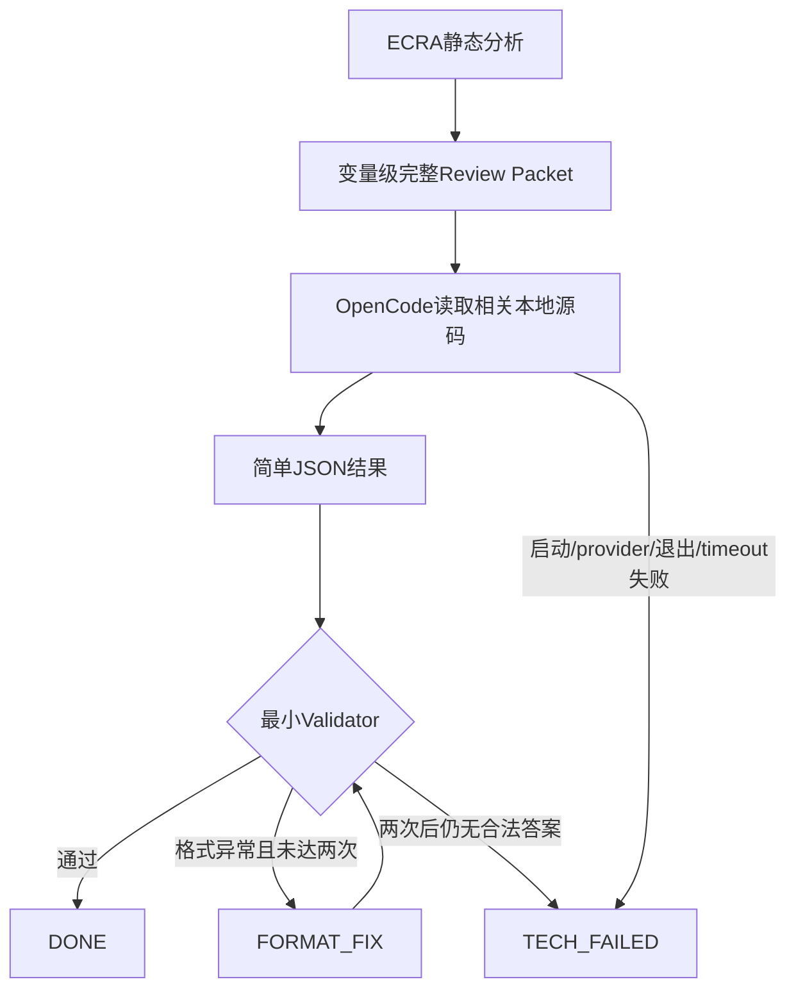

# ECRA 简单稳定的 OpenCode 变量级复核

## 1. 修改前问题

以修改开始时的本地源码为唯一基线。调用链为 `run_ecra.py → cli.main/run → analyze → review_all → parse_answer → queue/result → report.generate → html_report.write_html`；已有扫描由 `workflow.saved_run/checked_scan` 校验后调用同一 review_all。

候选由现有静态分析的 SUSPECT/UNKNOWN 产生，一个 canonical symbol/member/element 一个 finding；无法归属变量的覆盖缺口保留独立记录。现有源码没有本任务提及的 Conflict Class、递归 Partition 或 v3 协议，但实际存在 v2 解释协议、逐项 investigation、risk_override/冲突对门禁、可选反证第二轮。

旧 Packet 包含全部访问、上游函数、调用边、CFG 摘要及最多 1600 行函数正文；完整路径、保护等重复数据也被多处写入。旧答案必须输出参与者、场景、步骤和状态，中文长度也能导致整项失败。缓存策略曾让已有明确结论在 review 中被跳过。旧状态包括 RUNNING/FAILED/STALE，技术失败与语义证据不足的重试体验不清晰。

## 2. 为什么原复杂协议容易失败

逐 ID 回答数量随访问数增长，模型须同时完成源码推理、引用编号和大量展示结构，任一展示字段出错就使整体失效。格式错误重跑完整源码分析，扩大耗时和输出波动。大量函数正文与重复调用路径增加输入；反证第二轮还引入额外失败和历史结果恢复分支。

因此本轮删除新答案的这些协议约束，保留判断要求、完整事实、源码导航和独立归档校验。没有以减少候选、访问或隐藏 UNKNOWN 换成功率。

## 3. 新简化架构

`build_variable_review_packet()` 保留事实并提供导航；`review_all()` 组织批次和归档；`parse_answer()/validate_minimal_answer()` 只校验必要结构和源码位置；`format_fix_prompt()` 只整理已有分析。没有额外 agent、自动拆分或逐 pair AI 输出。

## 4. Review Packet 设计

保留所有访问字段：存储身份、file/line/function、READ/WRITE/RMW/整体对象/DMA/取址、上下文、可达性、别名、保护状态等。`call_chains/all_call_chains` 映射若重复，只在 `call_path_sets` 中存一次，每条访问用 `call_path_set` 引用；可逐字段还原，完整路径没有截断。

上下文、物理上下文、入口绑定、全部相关函数及调用边、递归边、保护事件/窗口、初始化证明、成员一致性、指针目标、地址逃逸、相关 unknown 和 variable_evidence_slice 均保留。CFG 节点、完整静态冲突记录和构建配置仍在原 facts/report 与共享 project-evidence.json 可读；Packet 用源码行区间与路径提供导航，不复制函数正文。

`concurrency_hints` 仅按上下文组合列出不同静态执行/保护评估，指导检查；不是新的复核对象，不要求模型逐项回应。既有静态冲突对及全部证据仍保存在 facts/report，静态分析实现未作修改。Packet 使用紧凑的多行 JSON，最长行在真实工程为 175 字符；不使用可能触发 read 单行截断的大行。Prompt 明确要求遇到分页/字节截断继续读取至文件末尾。

## 5. OpenCode Prompt 设计

按声明、所有访问、完整调用链、入口、保护、unknowns、直接关联源码检查；不足时继续读取 NVIC/IRQ、DMA、同步和别名相关代码。不无理由遍历全仓或整个 HAL，必要依赖可继续读。

核对当前构建、路径与回调参数、真实物理上下文、至少一方写、抢占/交错/硬件并发、完整保护窗口、初始化顺序、存储身份和关键运行条件。强调 Cortex-M 同级 IRQ 串行、main 不能抢占 ISR、普通对齐 store 顺序不自动证明缺陷、布尔通知合并须检查后续处理是否已覆盖事件、指针本体与 pointee 分离、不能编造业务后果。反证核查融入本次分析要求，不再增加第二次完整分析。

只读权限禁止修改、shell、子代理及外部发送；源码 read 按导航开放。FORMAT_FIX 的所有工具权限均 deny。权限和命令参数依据 [OpenCode 官方权限说明](https://opencode.ai/docs/permissions/) 与 [CLI 文档](https://opencode.ai/docs/cli/) 核对。

## 6. 简单 Schema

`finding_id/status/reason/interleaving/protection/impact/evidence/fix/verification/missing_context`，证据为 `file/line/claim`。不要求 schema_version、review_type、quote、explanation、participants/scenarios/steps、investigation 或 risk_override。旧结构只在历史显示层兼容。

CONFIRMED 表示有源码和执行关系证明风险；LIKELY 为有较强风险证据但少量条件未定；REVIEWED_SAFE 为完整证据证明不冲突或有效保护；FALSE_POSITIVE 为静态路径/对象/访问疑点被证伪；NEED_MORE_CONTEXT 为已分析源码但缺决定性事实。

## 7. 最小 Validator

只硬校验 ID 一致、合法 status、非空 reason、evidence 为列表和有效工程内文件/整数行号。CONFIRMED、REVIEWED_SAFE、FALSE_POSITIVE 至少一处 evidence；LIKELY、NEED_MORE_CONTEXT 至少一个非空具体 missing_context。文字长度、写作风格和可选展示字段不使复核失败。程序验证引用位置和归档一致性，语义正确性依赖源码核查和工程评审。

Parser 接受整体 JSON、fenced JSON、前后解释、OpenCode JSONL，以及最后一个匹配当前 finding_id 的完整对象；不吞掉 provider error 事件。

## 8. FORMAT_FIX 机制

正常分析的原始回答保留。parser/validator 结构失败才最多调用两次 FORMAT_FIX，仅传原始分析文字、具体错误、简单格式、finding_id 和五种枚举。没有源码附件、没有工具权限、没有复用源码会话；不得新增事实或改变原结论。合法 NEED_MORE_CONTEXT 直接 DONE，不触发格式修正。

正常执行的技术重试使用现有 retries；格式失败不重跑完整分析。timeout、非零退出、provider error 等仍是真正技术失败。只有工具/步骤事件而没有最终分析文字，也按技术失败处理：工具输出可能包含源码，不能把它作为原始分析送进 FORMAT_FIX。所有调用及错误、原始分析与格式修正日志都单独归档。

## 9. PENDING / DONE / TECH_FAILED 状态

PENDING：尚无当前有效答案（包括禁用复核、未处理或中断的当前项）。DONE：五种合法语义结果任一。TECH_FAILED：启动、执行、provider、超时、最终不可恢复格式、ECRA IO/归档一致性等技术问题。

`review_state/review_status` 明确分离执行与语义；保留 `state/status` 供现有报告兼容。旧 FAILED/STALE 映射为 TECH_FAILED、RUNNING 映射为 PENDING；失效答案只保留历史。源码/扫描变化仍要求重扫，不允许对过期事实直接复核。导航指向用已有 clean_report() 清理的 static-report.json，避免再次复核时读取包含旧 AI 答案的发布报告。

## 10. review 命令新语义

`py -3.10 run_ecra.py review` 校验现有静态检查点后，重新调用所有当前静态 SUSPECT/UNKNOWN，包括此前 DONE + 安全/误报/风险/证据不足。范围由静态分类决定，不由旧 AI 结论决定。完整 run 仍可复用当前指纹下的有效 DONE。

## 11. review-failed 命令

`py -3.10 run_ecra.py review-failed` 仅处理 TECH_FAILED，不重跑 DONE（包括 NEED_MORE_CONTEXT 和 LIKELY）。成功项退出失败集合；仍失败项保留，可无限次显式重试，无永久放弃阈值。max_items 仅限批大小，workers 控制 1–8 个会话，一次命令自动处理全部目标。

## 12. index.html 兼容方案

继续复用既有变量清单、顶层变量结果和中文栏目。简单答案直接映射为原因、时序、保护、影响、源码、修复和验证；missing_context 单独显示。格式修正/多次尝试不增加顶层变量行，历史归档放在原有折叠记录中。旧 v2 原文可显示，新格式不伪造参与者或场景。

## 13. 修改文件清单

- `ecra/common.py`：保持原子 JSON 写入，支持紧凑多行序列化；长提示词/格式修正走标准输入，避免 Windows 命令行长度限制。
- `ecra/review.py`：变量 Packet、导航 Prompt、容错解析、有限格式修正、只读执行、日志、批次及目标筛选。
- `ecra/review_contract.py`：简单格式与最小校验；删除 `ecra/review_risk.py` 和 `ecra/review_audit.py` 的额外输出门禁及第二轮。
- `ecra/review_integrity.py`：三态、别名一致性和旧状态迁移，保留 queue/result 完整性保护。
- `ecra/workflow.py`、`ecra/cli.py`：review 重跑语义及 review-failed，一致性检查保留。
- `ecra/review_presentation.py`、`ecra/html_report.py`、`ecra/report.py`：简单字段显示及技术失败中文展示。
- `ecra/config.py`、`config/semantics.yaml`：移除反证轮配置，保留简单设置与 workers。
- `tests/test_review_contract.py`、`test_review_integrity.py`、`test_review_risk.py`、`test_large_project.py`、`test_ecra.py`、`test_design_acceptance.py`、`review_fixtures.py`：更新协议与状态测试，保留静态回归并补充质量场景。
- README、本格式说明、使用教程和本报告同步更新；旧验证文档标为历史记录。

## 14. 自动化测试结果

最终源码完整测试 611 项全部通过，无跳过，用时 235.494 秒；已配置 Ninja/Arm GCC，包含真实生成 ARM ELF 对象的构建检查。日志：`output/review-full-tests.log`。使用本机 Python 3.12；`py -3.10` 在当前环境未安装。

真实 Clang 场景覆盖前台/IRQ、IRQ 抢占与串行、完整/部分 PRIMASK、BASEPRI、DMA、只读与初始化、成员/数组/别名、函数指针、不可达路径和全部路径还原；D01–D20 验收继续通过。协议模拟覆盖纯 JSON、解释/fence/多对象、长文字、证据路径/行号、五种 DONE、最多两次 FORMAT_FIX、超时/provider/退出、仅有工具事件无最终分析、批次并行、持久日志及篡改检查。10 项重跑、8 DONE+2 失败、再执行仅余下 1 项、CLI review-failed 再执行不调用 DONE 均有回归。

模拟 CLI 只证明机制；下面另外记录真实模型质量场景，不把模拟输出计作模型正确率。

## 15. 真实工程测试结果

工程：现有 `H:/stm32_RAG/code/serial - opencode` 的只读源副本，位于 `output/review-simple-validation/firmware`，不覆盖原工程 .ecra。使用相同 Debug 裸机构建、Arm GCC、20 个 TU 和 Core/Src、Core/Inc 排查范围，HAL 保留为依赖。

原实现的 Python 文件从任务开始时干净的 Git 基线保存为独立 baseline-engine；用它在同一副本先构建和扫描，再与新实现重扫比较，避免把历史 .ecra 的不同扫描结果误当基线。

2026-10-18，用户明确授权本次只读 OpenCode 复核与验证；编码仍由 Codex 直接完成。OpenCode 版本 1.18.35，本机默认模型经实际会话导出核对为 `deepseek/deepseek-flash`，最终运行显式指定同一模型。workers=4、retries=1、timeout_seconds=600。

完整首轮为 19 DONE + 1 TECH_FAILED；4 并发启动出现一次 OpenCode SQLite `database is locked`，按技术失败保留。实际 review-failed 只调用这 1 项，恢复后为 20 DONE；原有 19 项逐字段保持不变。再次 review-failed 为 0 目标，未重新调用模型。证明记录在 `retry_validation.json`；该次失败及后续尝试日志均保留。

最终代码重扫后，实际 `review` 又调用全部 20 个 SUSPECT（UNKNOWN 为 0），没有复用旧 DONE：

| 本轮指标 | 数量 |
|---|---:|
| 候选 / OpenCode 目标 | 20 / 20 |
| DONE / TECH_FAILED / PENDING | 20 / 0 / 0 |
| CONFIRMED / LIKELY | 0 / 0 |
| REVIEWED_SAFE / FALSE_POSITIVE | 12 / 8 |
| NEED_MORE_CONTEXT | 0 |
| timeout | 0 |
| 正常分析调用 / FORMAT_FIX 调用 | 20 / 2 |

两次 FORMAT_FIX 分别修正证据路径拼写和目录错误，原始分析、具体错误和固定格式提示词与实际修正输入逐字核对一致，未附 Packet、未接续源码会话。最终再执行 `review-failed` 为 0 目标，20 项 queue 逐字段及 attempt 数均不变；证明为 `format_fix_validation.json`、`final_empty_retry_validation.json`。

全部 20 项主工程和 4 项质量工程的原始日志、输入、答案及证据源码校验通过。最终主工程执行日志中完成的工具调用仅 337 次 read；7 次 read 失败原样保留，没有完成写入、shell 或子代理调用。与原工程对比的 85 个固件源码/构建配置文件 SHA-256 全部相同。两个 HTML 无重复 id；一个变量仍只有一个顶层结果。详见 `audit_final.json`。

主工程报告仍为 INCOMPLETE：原有静态覆盖缺口没有被消除或隐藏；这是静态覆盖状态，当前技术失败数为 0。表中是模型复核结论，不据此宣称全工程无风险。

额外质量工程使用真实 STM32 CMSIS、Arm GCC Cortex-M3 编译，配置两个定时器的时钟、周期、更新中断、NVIC、启动和 ISR 清标志，检查四个变量：前台/IRQ RMW、完整关中断保护、GPIO 输入决定的未知 IRQ 优先级、未被调用的静态写函数。期望状态保存在复核根目录之外，未提供给模型；真实模型四项均通过：cell_a=CONFIRMED、cell_b=REVIEWED_SAFE、cell_c=LIKELY 且列出实际缺失优先级条件、cell_d=REVIEWED_SAFE。未把未知优先级猜成安全，也未因简化漏掉真实 RMW 风险；原始日志和 quality_validation.json 在验证目录。

## 16. 优化前后输入规模比较

同一副本的原实现有 20 个候选，旧 Packet 平均 390177.55 字节、最大 605634 字节；任务开始时原工程历史 .ecra 为 23 个候选，平均约 427 KB、最大约 1.20 MB，仅作历史补充，不混用两套候选。

| 指标 | 原实现 | 新实现 |
|---|---:|---:|
| 平均 Packet 字节 | 390177.55 | 225888.45 |
| 最大 Packet 字节 | 605634 | 342099 |
| 候选 | 20 | 20 |
| 全部变量 | 58 | 58 |
| 已恢复访问 | 781 | 781 |
| 调用边 | 503 | 503 |
| 函数 | 1479 | 1479 |
| 执行/物理上下文 | 13 / 13 | 13 / 13 |
| unknown | 340 | 340 |
| 保护事件 / mask 窗口 | 73 / 576 | 73 / 576 |

平均缩小 42.11%，最大缩小 43.51%。两次完整 facts 的规范化 SHA-256 均为 `13ab53adca650ac7f6f7fe15bc7cf26a527436c2fa62dbef431b26674d953131`，所有事实逐字段相同，不只是计数相同。静态 SUSPECT 20、UNKNOWN 0、SAFE_PROVEN 29、容器 5、其他盘点记录 4；候选 ID 完全相同。

逐 Packet 还原核对了候选中的 321 条访问记录和 2281 条已枚举调用路径，字段及顺序完整一致。去掉的是大块函数正文和重复结构，未抽样访问或路径；原始 CFG、静态冲突和事实仍可按路径读取。机器记录为 [validation.json](../output/review-simple-validation/validation.json)，复核输入、HTML、日志在该目录的 `firmware/.ecra/`。可查看 [变量清单](../output/review-simple-validation/firmware/.ecra/index.html) 与 [OpenCode 复核结果](../output/review-simple-validation/firmware/.ecra/opencode_review.html)。

## 17. 已知限制

最小校验不证明模型推理正确，格式修正也不能补充未分析事实；不存在的源码和未知运行条件不能据此猜安全。现有静态过近似、函数指针/硬件/多核等边界继续保留。无板上验证，不声称硬件复现。

未对旧复杂协议执行同模型配对复核，因此不以本轮样本推断总体准确率，也不给出未经测量的故障率下降百分比。真实模型质量工程使用人工构造的四个小场景；其余质量回归核对真实 Clang 事实及输入完整性，不把模拟 CLI 的预设答案当作模型判断能力。

Packet 没有固定硬字节上限；若某个变量本身有大量独有事实，仍完整保留并允许技术失败后人工重试，不抽样、不自动 Partition。归档持续增长，遵循工程既有保留策略。源码或分析实现更新后仍需完整 run，不能把旧检查点作为新事实。
