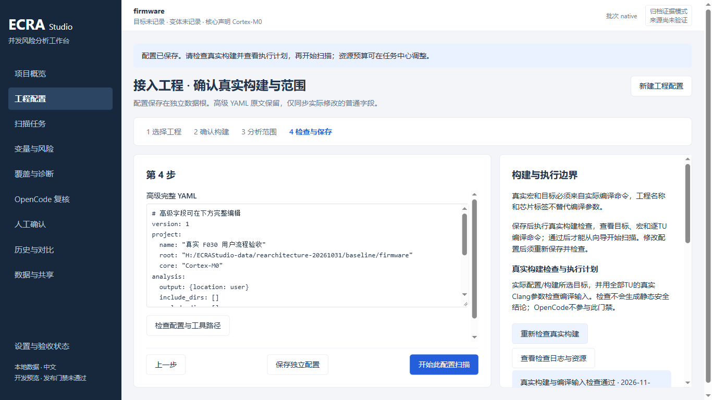
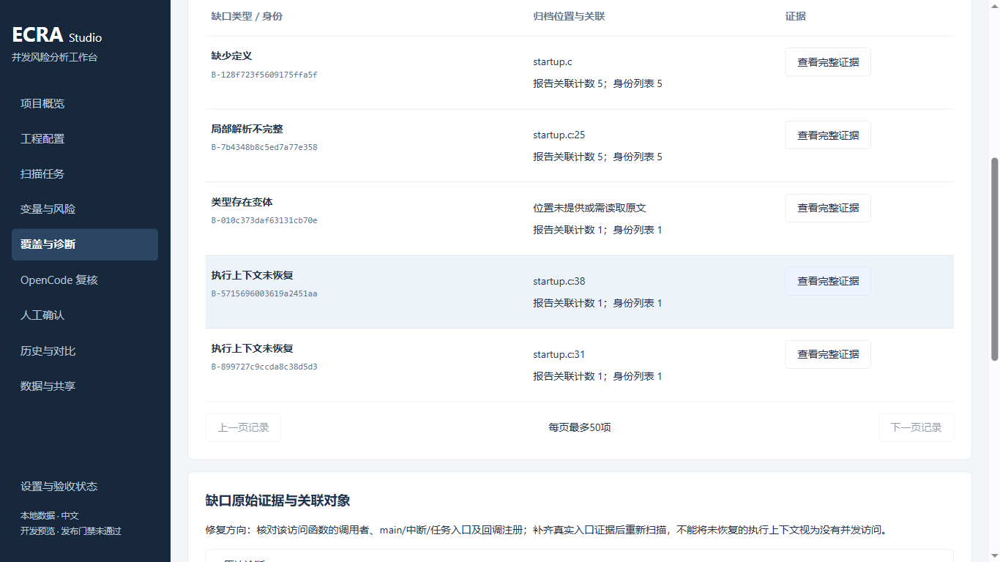
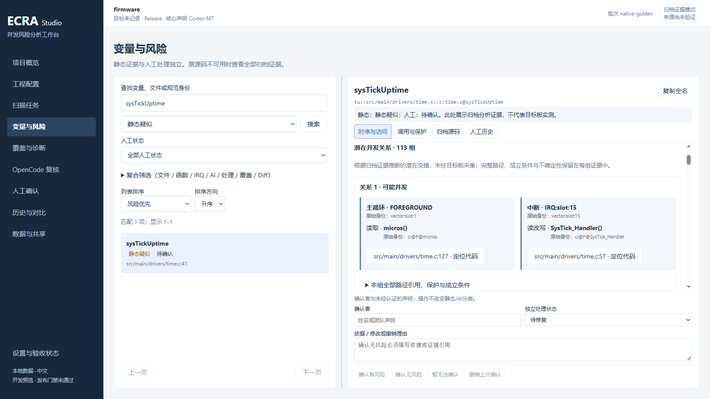

> v82 已调整界面布局和入口位置。请同时阅读[v82 新版工作台指南](studio-v82-layout-guide.md)；本教程的业务语义、确认与数据交接流程仍适用，旧截图按 v81 阅读。

# ECRA Studio v81：从第一次打开到完成一次并发排查

适用于 2026-11-07 的 v81 Portable。本文按实际界面按钮编写，先练习查看和确认，再接入自己的固件。普通操作不需要编辑 YAML，也不需要安装 Node 或系统 Python。扫描自己的工程仍需要真实编译输入、相应 SDK 和可用的工程工具链。

本版本是开发验收候选。本文说明可用操作，不代表全部工程、物理电脑和发布门禁已验证。首次使用建议先“打开示例”；示例有醒目标识，不会冒充你的工程。

| 你现在要做什么 | 从哪里开始 |
|---|---|
| 先学会看结果和填写确认 | 第 2 节：打开示例 |
| 排查自己的固件 | 第 3 节：新建工程 |
| 查看同事发来的结果 | 第 9 节：导入完整包 |
| 接着上次的排查工作 | 历史与对比 → 找到归档 → 继续人工确认 |
| 换盘、备份或恢复整套记录 | 第 10 节：整套数据复制与恢复 |

## 1. 启动软件，把数据放对地方

1. 如果收到 ZIP，先完整解压到独立的软件目录，不要直接在压缩包里运行，也不要只复制一个 `ECRA.cmd`。
2. 双击解压目录中的 **ECRA.cmd**，等待本地浏览器工作台打开。
3. 保留启动窗口。关闭浏览器标签不会停止后台服务；需要退出时，先处理未提交草稿，再在启动窗口按 Ctrl+C。
4. 下次重新双击 `ECRA.cmd`，使用本次启动器打开的页面。不要继续使用上一次启动留下的地址。

本次交付在这台电脑上的入口为：

```text
H:\ECRAStudio-build-20261107-studio-v81\ECRA-Portable\ECRA.cmd
```

软件、原固件、分析数据应是三个独立目录。下面仅为示例，请换成自己实际存在的盘符和路径：

| 内容 | 示例目录 | 用途 |
|---|---|---|
| 软件 | `D:\Tools\ECRA-Portable` | 程序和内置运行环境 |
| 原固件 | `D:\Firmware\MotorControl` | 你平时在 IDE 中维护的工程 |
| 分析数据 | `E:\ECRA-data` | 工程配置、扫描、归档证据、人工记录和外置构建 |

默认数据目录是 `%LOCALAPPDATA%\ECRAStudio\data`。大工程开始前，可以点击左下角 **设置与验收状态 → 独立数据根**，填写独立空目录，点击 **检查数据目录 → 保存为下次启动目录**。然后退出并重新启动，在同一页面核对“当前使用”。

只修改“下次启动目录”不会搬走旧数据。已有记录需要搬迁时按第 10 节操作。若页面提示启动参数或 `ECRA_DATA_ROOT` 环境变量优先，当前指定位置不会被这个默认设置覆盖。

## 2. 第一次使用：先在示例上完成一次操作

1. 在 **项目概览** 点击 **打开示例**。已有扫描时，这个按钮位于“最近扫描与下一步”。
2. 确认页面显示“教学示例”提示。它是真实分析得到的教学归档，不是你的固件，也没有目标板验证。
3. 点击概览中的 **静态疑似**，或者打开左侧 **变量与风险**，选择一个疑似变量。
4. 在右侧 **时序与访问** 查看谁读、谁写；展开潜在并发关系，点 **定位代码** 或 **定位此访问代码**。
5. 切到 **调用与保护**，查看这些访问是从哪个入口到达，以及保护证据是否充分。
6. 在下方“确认者”填写自己的姓名或团队声明，在“依据 / 修改或撤销理由”写一段练习说明。暂时没有充分结论时，点击 **暂无法确认**。
7. 等页面明确显示“已保存”，打开 **人工历史**，核对刚才的文字和决定。
8. 如需练习撤销，填写“教学练习，撤销本次确认”等理由，再点 **撤销上次确认**。原记录应仍在历史中。

完成标准是：你能找到一个对象的访问位置、知道在哪里看证据、提交一条带依据的决定，并在历史中找到它。不需要把示例中每个疑似都处理成安全。

## 3. 接入自己的工程：四步向导

点击 **项目概览 → 新建工程**；已有项目时，也可从 **工程配置 → 新建工程配置** 进入。

### 第一步：选择工程

填写工程名称和原固件目录的绝对路径，可以点击 **选择固件目录** 浏览。工程名称用于区分项目，不能替代编译目标或芯片参数。

### 第二步：确认构建

根据工程已有的真实构建方式选择：

| 选择 | 要填写什么 | 要核对什么 |
|---|---|---|
| **CMake + Ninja（外置构建）** | 目标名称、Toolchain 文件、构建变体 | 目标属于这个工程，Toolchain 对应实际固件，Debug/Release 与要排查的版本一致 |
| **已有 compile_commands.json** | 数据库的实际路径 | 数据库由目标工程生成；里面的源文件、编译器、头文件和宏仍可访问，不能拿别的目标或旧版本凑用 |

“核心标识”按实际情况填写，也可保留默认；它不会自动补齐 CPU 参数或宏。真实参数以编译命令为准。

“编译器标准头文件”默认是 **CMake 开启 / 数据库关闭**。选择从实际编译器探测时，那个编译器必须可用。缺头文件时先核对工具链、SDK 和编译命令，不要为了让扫描继续而随意删掉 include 或宏。

只有 IDE 工程文件、没有有效编译数据库或受支持的 CMake 构建时，单选固件目录还不够。应先从实际构建取得编译输入，再继续向导。

### 第三步：分析范围

“变量定义纳入目录”每行一个，例如 `Core/Src`、`Core/Inc`；空表示全部。也可以使用目录树选择。“排除变量清单目录”仅排除这些目录的变量清单，相关代码仍参与调用恢复。

检查 **执行入口 · main / ISR / 任务**。自动识别会按已有分析配置继续工作；需要补充时，填写实际存在的函数名，每行一个，并选择相应入口类型。不要把普通函数随意标成中断或任务，也不要猜测优先级和并发关系。

第一次扫描先把 **Diff 基准 ref** 留空，做全量扫描。需要检查未提交改动时，另按第 8 节设置；不要误以为选择 `HEAD` 就已包含所有未提交文件。

### 第四步：检查与保存

1. 点击 **检查配置与工具路径**，处理列出的缺失路径或工具。
2. 点击 **保存独立配置**。普通字段已生成配置，无需为了开始扫描手改高级 YAML。
3. 在右侧点击 **检查真实构建**，等待完成；可以进入 **查看检查日志与资源**。
4. 核对目标、变体、独立数据路径和编译单元数量。展开关键源文件的实际编译参数，确认芯片宏、include、CPU 和 ABI 与工程一致。TU 是编译单元，通常对应按一组参数编译的一个 C/C++ 源文件。
5. 检查通过后点击 **开始此配置扫描**。

修改配置后必须重新保存和检查。历史检查记录只供查阅，不能代替当前配置的检查。

下图是 F030 工程的实际预检查；路径和数量属于测试工程，不应照抄到你的工程：



## 4. 扫描过程中和结束后应该看什么

在 **扫描任务** 中选择对应任务，查看真实阶段、TU 数量、日志和资源。首次可以保留“自动”资源预设；预算是运行限制，不是扫描必定完成的保证。

需要中止时点击 **安全停止**，等待状态结束。之后可使用 **从已验证 TU 恢复 / 重试**。软件会重新核对输入，只复用能够证明匹配的缓存，不承诺从任意进度百分比接着运行。已固定的 CMake 输入发生变化时，恢复可能被拒绝，应从工程配置发起新扫描。

出现 **打开扫描结果** 后进入结果，再检查 **覆盖与诊断**。任务“扫描已发布”与分析“覆盖完整”是两件事：本轮实际 F030 就发布了部分覆盖结果，不能当成整个工程已验证安全。

| 页面状态 | 应当怎样理解和处理 |
|---|---|
| 静态疑似 | 有需要核实的证据，进入对象逐项调查 |
| 无法判断 / UNKNOWN | 条件或证据不足，查看覆盖缺口，补齐后再判断 |
| 本构建已证明安全 | 结论受本次构建、输入及已记录条件约束，不代表所有目标或未来版本 |
| 部分覆盖 / PARTIAL / INCOMPLETE | 有一部分未能完整分析，先看具体原因和影响对象 |
| 未进入本构建 | 当前目标没有覆盖它，不能据此判断安全 |
| 容器汇总 | 是汇总对象，不能直接当作一个已确认风险或安全结论 |

覆盖页会给出处理建议。例如“执行上下文未恢复”，需要核对调用者、main/中断/任务入口及回调注册；不能把缺失入口当作没有并发访问。



## 5. 排查一个变量：固定按这条路线走

目标是回答：**哪个对象，由谁读写，从什么入口到达，什么条件下可能交错，现有保护能证明到什么程度？**

1. 在 **变量与风险** 的“查找变量、文件或规范身份”输入变量名，点击 **搜索**。没有结果时，先清理静态分类、人工状态和复合筛选，检查是否仍处于“精确定位”。
2. 对照定义文件及规范身份选中正确对象。同名 `static` 可能属于不同文件或编译单元，不能只看名字合并结论。
3. 打开 **时序与访问**，看读、写、读改写的位置及潜在并发关系的双方。v81 优先显示归档函数名和执行上下文，下面保留原始身份供核对。
4. 对每一方点击 **定位代码** / **定位此访问代码**。在 **归档源码** 看高亮目标行及前后文，可以跳转行、查看前后代码段。这是本次归档的源码，不保证等于今天 IDE 里的文件。
5. 打开 **调用与保护**，沿调用树核对入口、调用路径、保护窗口及未知条件。展开“本组全部路径引用、保护与成立条件”等完整证据；关系超过一页时继续翻页。
6. 查看 **覆盖与诊断** 中是否存在影响该判断的缺口。仅有保护 API 名称、一个函数名或一组潜在关系，不足以替代完整条件核对。
7. 把观察、还缺什么、准备怎样验证写到下方依据里，再按第 6 节提交决定。

下面是实际 INAV 归档中的一组关系：`micros()` 属于主循环侧，`SysTick_Handler()` 属于中断侧。它告诉你从哪里开始检查；截图本身不证明每一次访问都会冲突，也不提供硬件实测时序。



长列表、证据和源码区域可分别滚动；列表与证据之间的分隔条可调整宽度。工作台中 Ctrl+F 会聚焦变量搜索；Esc 收起当前详情，v81 保留本窗口内的调查草稿。

## 6. 记录依据、确认、撤销和继续工作

先填写“确认者”和依据，再选择实际结论：

| 按钮 | 适合什么时候用 |
|---|---|
| 确认有风险 | 已有足够证据，能说明触发条件和影响 |
| 确认无风险 | 已核对相关路径和保护条件，有明确依据；依据不能为空 |
| 暂无法确认 | 仍缺入口、调用关系、硬件条件或其他必要证据 |
| 撤销上次确认 | 之前的决定需要撤回；填写原因，原决定仍保留在历史中 |

“独立处理状态”用于安排工作：待修复、修复中、待验证、已关闭、接受风险。它与风险决定是不同维度；选择“已关闭”不会自动让静态疑似变为安全。处理状态和依据随这次确认操作提交。

依据可按下面模板填写，把内容换成实际证据：

```text
对象：规范身份、定义文件及位置。
访问双方：入口/上下文、函数、读写位置。
已核对：相关调用路径、保护条件及归档证据位置。
当前判断：风险成立 / 已排除 / 仍缺什么条件，以及理由。
下一步：修改方案、补充证据或目标板验证事项。
```

**点完按钮后等“已保存”，再到人工历史核对。** 确认者是填写的声明，不是经过登录认证的身份。人工决定不会改写静态分类。

草稿只保存在当前浏览器窗口：切换变量、页面或按 Esc 可以保留，刷新、关闭或程序重启不保证恢复。离开提醒出现时可以取消并返回处理；不要把提醒当作已保存。尚未准备提交决定时，可将文字另存到自己的工作记录。

读取当前对象失败时，确认按钮会禁用，重新点击对象重试。提交失败时草稿保留；若界面已明确“已保存”而后续统计刷新失败，先检查人工历史，不要直接重复提交。

第二天继续时，从 **人工确认 → 继续上次位置**，或从 **历史与对比 → 继续人工确认** 进入。重新扫描后，只有完整输入和事实能证明未变时才沿用旧确认；“需重新确认”表示需要重新核对，不能仅按同名变量沿用旧安全决定。

## 7. 改完代码后怎样复查

1. 在自己的 IDE 修改固件并按原工程方式构建、验证。
2. 回到 **项目概览 → 按此配置重新扫描**。目标、工具链或范围变化时，先修改配置、保存并重新检查。
3. 新扫描发布后先检查覆盖，再重新查看原对象及其关联访问。
4. 在 **历史与对比** 将旧归档 **设为对比基准**，在新归档点 **与基准对比**，核对变化及原因。
5. 有新的证据后更新人工决定和处理状态，原历史仍保留。

历史归档对比比较的是两份已保存结果，不会代你重新扫描源码。“本轮未观察到”也不能单独证明已修复，应检查构建范围、覆盖和对象身份是否发生变化。

## 8. 进阶：比较两个 Git 版本，或检查未提交改动

在工程配置第三步的 Git 区域，先点击 **读取并核对本地 Git 版本**，核对仓库、HEAD、暂存/工作区/未跟踪/冲突数量。

| 目的 | Diff 基准 ref | 当前 ref | 纳入当前工作区未提交输入 |
|---|---|---|---|
| 比较两个已提交版本 | 旧分支、标签或提交 | 新分支、标签或提交 | 不勾选 |
| 检查相对当前提交的本地修改 | `HEAD` | `HEAD` | 勾选 |
| 检查相对一个旧版本的当前实际工作区 | 旧分支、标签或提交 | `HEAD` | 勾选 |

勾选后分析的是工作区实际字节，不是只分析暂存区；不勾选的固定提交比较不包含未提交修改。选择后重新检查、保存、检查真实构建，再扫描。

结果中的 **Diff 影响范围** 可以区分全部影响项、确定依赖影响项和保守扩大项。它们仍需结合完整证据检查；不要把影响项数量当作确认的缺陷数量。

v81 对 CMake 未提交输入有明确准入范围：Windows/Ninja 外置构建，必须通过真实输入固定检查。未证明的自定义生成命令、联网下载、`try_run` 等会被拒绝；未提交 CMake 的显式 ELF/MAP 闭包仍未准入。阻断时看实际原因，不要删掉真实输入来绕过检查。大型整轮 Diff/恢复的最终验收仍未完成，不能据小工程流程通过推断所有大工程可用。技术边界见 [117号](rearchitecture/117-cmake-working-input-contract.md) 和 [121号](rearchitecture/121-managed-cmake-artifact-binding-contract.md)。

## 9. 把结果交给同事，或者接收同事的确认

首次交接完整结果：

1. 在 **历史与对比** 打开要交接的那一次扫描，核对当前工程及批次。
2. 进入 **数据与共享 → 导出当前归档**，点 **导出标准完整包**。
3. 等浏览器下载 `.ecra-report` 完成后交给同事。省空间与快速压缩都保留完整证据，主要区别是压缩时间和包大小。
4. 接收方启动自己的 ECRA，在 **数据与共享 → 选择 .ecra-report** 中导入，等“导入已提交”后查看。

已有同一归档，只交换新增人工确认：

1. 完成确认的一方点 **导出人工确认增量**，得到 `.ecra-review-delta`。
2. 接收方先打开它对应的原扫描，再在 **数据与共享 → 选择 .ecra-review-delta** 中导入。
3. 在人工历史中核对原作者、依据和决定。重复导入去重；双方并行决定冲突时需查看双方记录、填写依据并显式解决。

完整包可以在没有原固件的电脑查看已归档证据并继续人工确认；重新扫描仍需要真实工程和构建环境。增量包不能代替完整结果包。文件可能含源码和备注，应按团队允许的范围交接。

损坏文件或归属不匹配时保留原记录，按提示核对文件完整性、当前归档及数据盘空间后重试；不要改后缀冒充另一种包。

## 10. 备份、换盘和恢复整套数据

1. 等扫描、导入等当前工作结束，处理未提交草稿。
2. 打开 **设置与验收状态 → 独立数据根 → 整套数据复制与恢复**。
3. 备份当前数据时填写独立的目标空目录；从旧备份恢复时勾选 **从另一完整Studio数据目录恢复副本**，另选来源和目标。
4. 点击 **检查整套复制计划**，核对源、目标、文件数和占用，再点 **开始完整复制并校验**。
5. 成功后若要切换使用新目录，在上方把它保存为下次启动目录；退出并重新启动，检查历史及人工记录。只做备份则不必切换。

复制保留原目录。中断后有有效校验日志时，可使用 **重新校验并恢复复制**；来源已变时应重新检查计划。新根重新建立活动构建所需目录，若编译输入仍依赖旧盘符，会要求修复或重新检查，不能把换盘等同于外部 SDK 和固件也已迁移。

升级软件时保留数据根。不要手工删改 `scan.db` 或证据文件来释放空间；需要整理时使用软件的空间预览，核对隔离和恢复说明后操作。

## 11. 常见卡点怎么处理

| 遇到的情况 | 先做这件事 |
|---|---|
| 开始扫描按钮灰色 | 检查当前配置是否保存，并完成本次真实构建检查；改配置后重新检查 |
| 工具或头文件缺失 | 展开工具路径、原始编译参数和诊断，核对实际编译器、SDK、宏和 include |
| CMake 被明确阻断 | 查看哪种构建操作不满足准入，保留诊断；不要删除检查或输入伪装通过 |
| 搜不到一个知道存在的变量 | 清除残留筛选和精确定位，核对当前工程、归档及是否进入该构建 |
| 扫描结束仍有未知或部分覆盖 | 到覆盖与诊断看具体缺口，补齐条件；不能批量确认安全来消除状态 |
| 归档源码缺失 | 检查该归档是否真的保存了它；不要拿当前源码冒充旧证据 |
| 确认按钮灰色 | 等当前对象读完、填写确认者；确认无风险及撤销还须填写依据。读失败则重新选对象 |
| 重开软件看不到上次结果 | 检查当前数据根及显式启动设置，再到历史检索清空筛选；先不要移动或删除旧目录 |
| 导入失败 | 核对完整文件、增量归属、数据盘空间；重选文件，仍失败保留诊断编号 |
| OpenCode 不可用或技术失败 | 先继续静态证据和人工调查；模型复核是可选功能，需要单独配置外部工具/提供方，技术失败不代表安全 |

## 12. 本教程的依据与使用范围

按钮和路径已对照 v81 对应源码核对。真实操作证据见 [v81 用户工作流验收记录](rearchitecture/127-real-user-investigation-workflow.md)：F030 四步配置及实际扫描、人工确认/撤销/增量交接、INAV 113 组关系及三种窗口尺寸。截图来自这些实际操作；其他工程的对象、路径、数量和覆盖结果应以自己的扫描为准。

整轮大型 Diff/恢复、其他待验 G2 工程、物理 32GB 电脑、干净离线电脑、系统 DPI、真实模型和人工 UAT 尚不能视为全部通过。教程编写本身没有新增这些验收结果，也没有更改扫描语义或放宽严格对照规则。

本教程是 v81 封存后补充的仓库文档，不在原 ZIP 中；原封存包不作静默替换。旧版 [命令行教程](one-command-tutorial.md) 和 [变量排查案例](variable-investigation-guide.md) 保留供历史与原理参考，其中 HTML 报告入口及输出目录不要套用于 v81。v81 日常操作以本文为准，历史验收状态见 [阶段说明](rearchitecture/portable-and-user-guide.md)。
