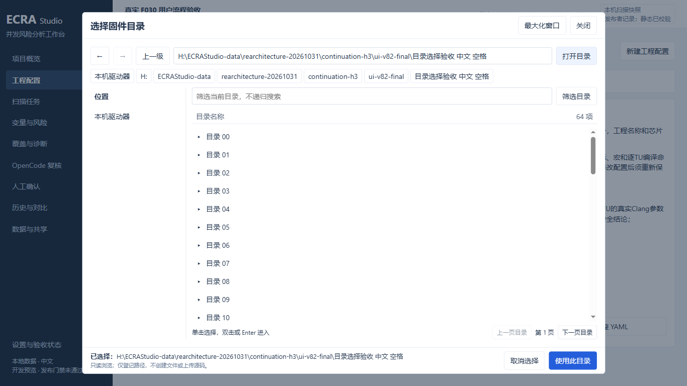
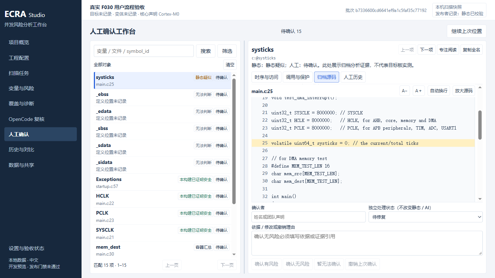
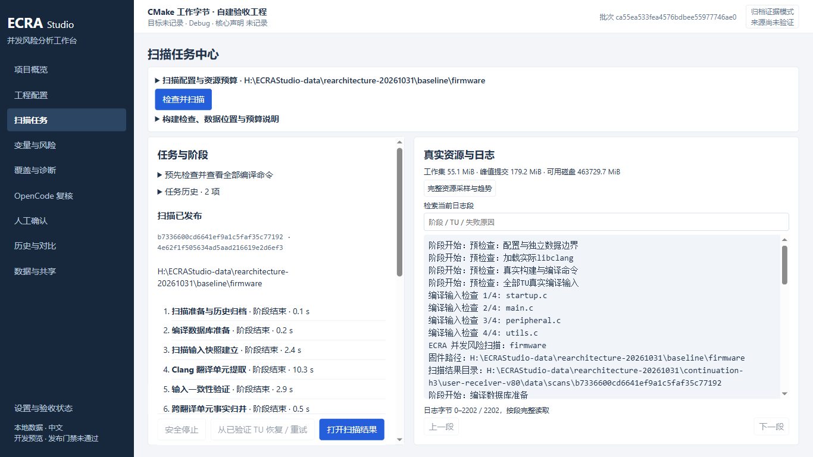

# v82 新版工作台怎么用

最终分发 v83 包含本页的 v82 布局，以及弹窗内错误提示修复。本机双击 `H:\ECRAStudio-build-20261107-studio-v83\ECRA-Portable\ECRA.cmd` 启动；交接到另一目录或电脑时，完整解压同目录的 `ECRA-Portable.zip`，再运行其中的 `ECRA.cmd`。

本版按工程师连续排查的顺序调整了全部九个主页面及设置。分析规则、静态分类、AI 状态和人工确认仍分别保存。完整业务教程继续参见 [v81 用户教程](studio-v81-user-tutorial.md)，界面位置以本页为准。

## 选择工程和构建文件

在“工程配置”点击“选择固件目录”。窗口可以最大化，左侧是位置和最近选择，中间是当前层目录。单击选中、双击或 Enter 进入；Alt+左/右返回或前进，Alt+上进入父目录，Ctrl+L 编辑完整路径。底部明确显示最终选中的目录；取消不改变原字段。

列表按当前目录分页，筛选只作用于当前层，不会递归搜索磁盘。链接或 Junction 不会被跟随。第二步可直接选择 `compile_commands.json` 或 `.cmake` Toolchain 文件；这些操作只登记路径，后续仍须执行真实构建检查。

第三步使用“纳入与排除 / 执行入口 / 版本对比”分组。第四步先检查和保存，高级 YAML 在“高级完整 YAML”中展开；未知字段和原文备份仍保留。检查通过后，可在独立大窗口查看全部真实 TU 参数。

## 排查变量并作出确认

进入“变量与风险”或“人工确认”。左侧搜索和列表用于挑选对象，点击“筛选”设置静态类别、人工状态、文件、函数、上下文和 Diff 等条件；当前条件会显示在搜索框下方。

右侧使用“时序与访问 / 调用与保护 / 归档源码 / 人工历史”切换证据。“上一项 / 下一项”只切换对象，不自动提交。“专注阅读”暂时隐藏左侧列表，再点“恢复双栏”返回。窄窗口使用“返回列表”切换列表和详情。

源码可以调整字号、自动换行或放大阅读。查完证据后填写确认者、独立处理状态及依据，再明确点击确认或撤销。**草稿只保留在当前窗口，刷新或关闭前仍须提交；正式记录才会持久保存并随结果包交接。**

Git 摘要分别列出“影响清单”和“保守潜在影响”，两项不表示包含关系。“范围与完整证据”可查看完整比较方向、固定版本及回退依据。

## 其他常用页面

| 任务 | 新位置和操作 |
|---|---|
| 检查扫描进度与日志 | “扫描任务”：配置默认收起，阶段在左、日志在右；完整内存、磁盘和趋势在独立窗口 |
| 核对解析失败和编译参数 | “覆盖与诊断”：选中左侧记录后，右侧读取完整证据；“全部归档索引”打开大窗口 |
| 查看 AI 待办、答复与收据 | “OpenCode 复核”：选择列表对象查看右侧详情；打开页面不会调用模型 |
| 查找旧扫描并作比较 | “历史与对比”：紧凑表格；“详情与操作”中设置基准、对比、继续确认或导出 |
| 导入和导出结果 | “数据与共享 → 结果交接” |
| 迁移旧格式结果 | “数据与共享 → 旧结果迁移” |
| 查询占用和清理 | “数据与共享 → 空间与清理” |
| 合并已有多核结果 | “数据与共享 → 多核合并” |
| 设置目录、整套复制恢复、空间策略 | “设置与验收状态”中的三个独立分组 |

本轮自动化已检查真实 F030、既有 CMake 未提交修改 Diff 包和大型 INAV 归档。它不替代真实工程师 UAT、Windows 原生 DPI、32GB 真机、干净离线电脑和其他待验工程。完整验证范围及新便携包状态见 [128 号验收记录](rearchitecture/128-engineering-workspace-usability.md)。
