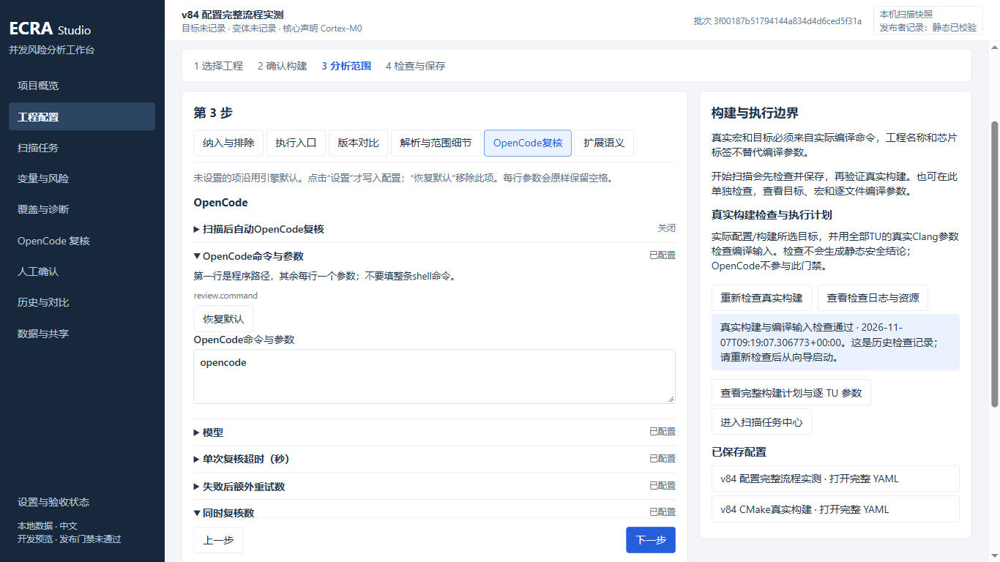
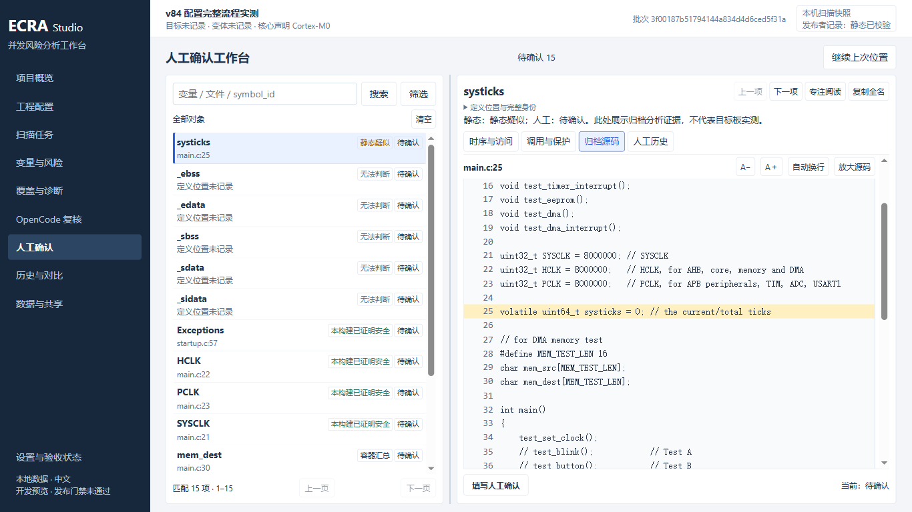

# 配置与人工确认操作说明（v86最终版）

本机入口：`H:/ECRAStudio-build-20261107-studio-v86/ECRA-Portable/ECRA.cmd`。

## 配好后怎样开始扫描

在“工程配置”填写四步后，点击“开始此配置扫描”。它会依次检查配置、保存独立副本、检查真实构建，再开始扫描。右侧显示进度和失败原因；失败时修正后再点开始即可。也可单独保存或检查构建，不必立即扫描。

已有 semantics.yaml：点击页面上方“从现有 YAML 导入”。导入后点“上一步”查看和修改表单。导入只建立独立配置，不覆盖工具的原 semantics.yaml。固件目录须为绝对路径。

## 配置项在哪里

- 第1步：工程路径、名称；展开工程选项填写芯片、字长和NVIC位数。
- 第2步：构建方式、目标、工具链、变体、系统头文件。CMake细节中有生成器、配置参数、构建参数、清理开关和超时。
- 第3步“纳入与排除”：变量所在目录；“解析与范围细节”：排除文件、预期宏、解析超时、并行数等。
- 第3步“执行入口”和“版本对比”：真实main、任务、中断及Git比较方向。
- 第3步“OpenCode复核”：启用开关、命令、模型、超时、重试、并行数和摘要。首次接入建议关闭自动复核，先确认静态扫描能正常完成。命令第一行填程序路径，其余每行一个参数，不填整条shell命令。
- 第3步“扩展语义”：自定义注册、调用边、并发/抢占和临界区等。每段带说明与JSON例子；只修改所选段，其余原文保留。不确定时保持未设置。
- 第4步“核对全部已有配置项”：逐项列出原配置中的字段和编辑位置。未知字段在高级原文中保留；输出位置到“设置与验收状态”管理。旧open_report开关不会让Studio扫描生成旧HTML。

未设置的附加项沿用引擎默认；“设置”明确写入，“恢复默认”移除此字段。配置的解析并行数默认用于向导扫描，任务中心可显式覆盖，低内存模式限制为1。

## 人工确认怎样阅读更舒服

默认收起底部填写区，把空间留给证据。先看“时序与访问”的理由和访问位置，或切到“归档源码”。“调用与保护”只列需要进一步核对的内容；追溯调用入口、技术原文和完整对象均点击展开。

准备记录结论时点击“填写人工确认”，输入确认者和依据，再点击相应决定。收起、切换对象会保留当前窗口的草稿；刷新或关闭前须正式提交。撤销会新增历史事件，原确认仍可在“人工历史”查看。

本轮验收范围与尚待验证项见 [129号记录](rearchitecture/129-configuration-and-review-usability.md)。
