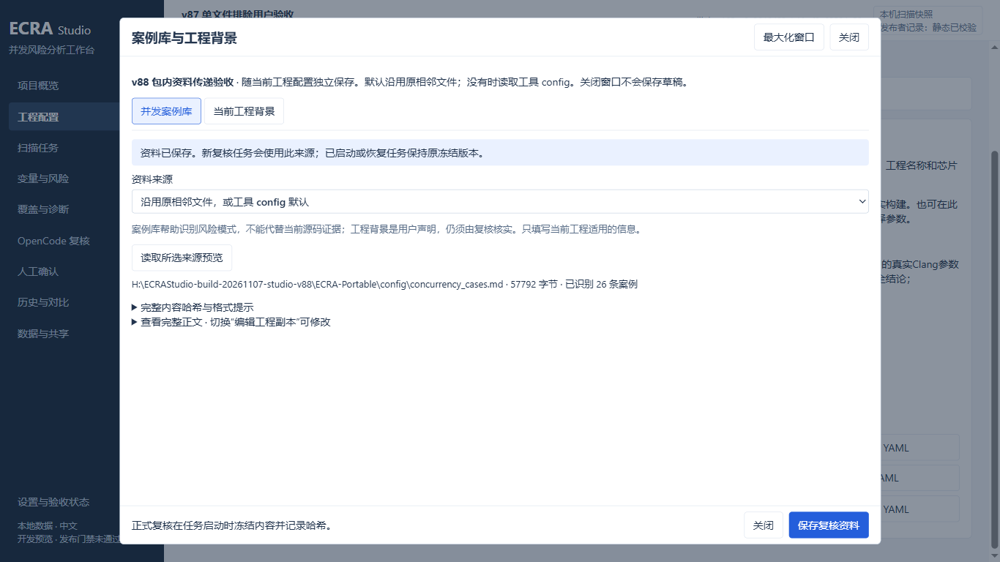
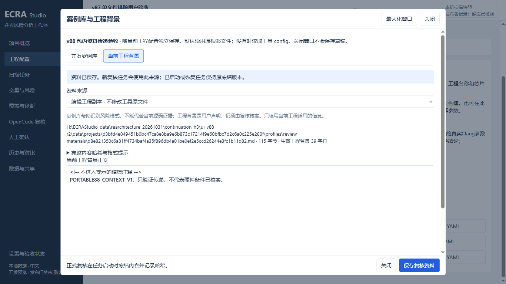

# 案例库与工程背景怎么配置

本机最终入口：`H:/ECRAStudio-build-20261107-studio-v88/ECRA-Portable/ECRA.cmd`。本版也包含直接选择单文件排除的修复。

在“工程配置 → 第3步 → OpenCode复核”，点击“保存配置并设置复核资料”。已保存的配置也可在第4步右侧直接点击“案例库与工程背景”。“OpenCode复核”主页面同样有这个按钮，使用当前选中的复核配置。

窗口有两个分组：

- 并发案例库：默认读取原相邻文件；没有时读取当前工具config/concurrency_cases.md。显示实际来源、完整哈希、字节数、可识别的CASE数量与格式警告。
- 当前工程背景：对应review_context.md。默认模板只有HTML注释，注释不会送给模型；页面会明确显示生效背景为0。填写真实入口、优先级、运行阶段、生命周期和源码依据即可，不必重复复制扫描数据。

资料来源可以选择：

1. 沿用原相邻文件或工具config默认：兼容原来CLI的维护方式，下一轮重新读取最新内容。
2. 本机Markdown文件：直接选择已有案例库或review_context.md，每轮读取最新保存内容；换电脑需要重新选择路径。
3. 编辑工程副本：在窗口中编辑并保存，内容放在独立数据根，随整套数据搬迁；不会改写工具config原件。
4. 工程背景还可明确选择“不提供额外工程背景”。

点击“读取所选来源预览”核对文件，再点“保存复核资料”。保存配置文件本身不会把背景写进YAML；它们是该配置关联的独立Markdown资料。切换工程时各配置独立维护。来源文件不存在会显示错误，不能把错误路径当作已保存成功。

扫描后自动复核、手动复核全部、仅重试技术失败都会在任务启动时冻结两份资料。修改只影响之后新建的复核，已启动或恢复任务使用原冻结版本。任务中心可展开“本任务实际使用的复核资料”核对来源与哈希。案例索引、正文阅读要求和原八步复核不变。

高级离线核对可打开“关闭自动复核时仍准备输入”：自动复核关闭时仍生成Packet与提示词，不调用模型；自动复核开启时仍会调用模型。

验证范围、实际入口和未验项目见[131号记录](rearchitecture/131-review-materials-handoff.md)。联网模型未实际验证时不会宣称通过。

已运行的旧任务保持原输入。配置好后，请从“复核全部疑似与未知”新建复核；仅重试技术失败不会重跑已有成功项。
